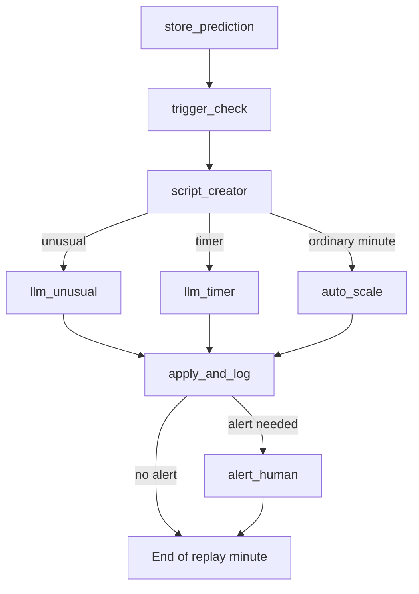
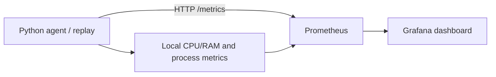

# AegisCloud — Agentic AI Cloud Resource Allocator

AegisCloud is a student research and engineering project that combines **LSTM traffic forecasting, a LangGraph decision workflow, guarded scaling decisions, alert emails, and Prometheus/Grafana observability**. It replays historical Azure Functions traffic and evaluates what the allocator would decide minute by minute.

> **Current status — 26 October 2026:** the historical replay workflow, saved LSTM models, fake/real-provider integration, email-alert path, and local Prometheus/Grafana monitoring are implemented. The monitoring stack reports replay values plus real CPU/RAM measurements for the Python process and its host machine. **Replica counts are still simulated:** `set_replicas()` is a placeholder, and this project does not yet create or remove real Docker containers or Kubernetes Pods. A completed live-scaling adapter, startup-delay simulator, and policy-comparison evaluation remain future work.

---

## Contents

- [Project goals](#project-goals)
- [Architecture](#architecture)
- [What is implemented](#what-is-implemented)
- [Repository layout](#repository-layout)
- [Requirements](#requirements)
- [Installation](#installation)
- [Configuration and secrets](#configuration-and-secrets)
- [Run the forecasting model](#run-the-forecasting-model)
- [Run and test the agent](#run-and-test-the-agent)
- [Prometheus and Grafana monitoring](#prometheus-and-grafana-monitoring)
- [Metrics reference](#metrics-reference)
- [Email alerts](#email-alerts)
- [Forecasting experiment and results](#forecasting-experiment-and-results)
- [Testing checklist](#testing-checklist)
- [Known limitations](#known-limitations)
- [Roadmap](#roadmap)
- [Security notes](#security-notes)
- [License](#license)

---

## Project goals

Traditional autoscalers commonly react to current CPU or request load. A forecast can provide earlier warning of an upcoming demand increase, while a controller and guardrails can constrain the resulting scaling decisions. AegisCloud explores this workflow with:

1. An **LSTM forecaster** that predicts request volume 10 minutes ahead.
2. A **rule-based controller** that handles ordinary minutes without an LLM call.
3. **LangGraph orchestration** that invokes an LLM for periodic reviews or unusual conditions.
4. A **guardrail** that bounds every proposed replica count.
5. **Alert generation and optional SMTP email** for situations that may require a human.
6. **Prometheus and Grafana** for observing replay behavior, agent performance, alert outcomes, and local process/host resources.

This project is currently a **replay-based prototype**, not a production autoscaler. The LLM is not called for every HTTP request or every replay minute.

## Architecture

### Decision workflow



One pass through the graph processes one row/minute from the selected historical trace. It does not send that row's traffic to a live application.

| Node | Responsibility |
|---|---|
| `store_prediction` | Reads the selected app's current trace value, runs the trained LSTM to forecast traffic at `t + 10`, and records the prediction. |
| `trigger_check` | Selects the `unusual`, `timer`, or `auto` decision mode. |
| `script_creator` | Builds a short report from recent predictions, errors, traffic, replicas, and actions. |
| `llm_unusual` | Calls the configured LLM when an unusual condition is detected. |
| `llm_timer` | Calls the configured LLM for periodic review. |
| `auto_scale` | Uses a deterministic formula for ordinary minutes. |
| `apply_and_log` | Applies the replica-count guardrail, records the decision, and evaluates alert conditions. |
| `alert_human` | Creates an alert message, saves it to disk, and attempts SMTP delivery when email is enabled. |

### Monitoring workflow



Prometheus and Grafana run in Docker. The Python agent runs separately on the host and exposes the `/metrics` endpoint. The metrics include both replay/simulation data and live resource readings for the Python process and host machine.

**Important distinction:** `cloud_allocator_replicas` represents the agent's simulated replica count. It is not a count of running Docker containers, Kubernetes Pods, or cloud instances.

## What is implemented

- Saved per-app LSTM checkpoints for the supported apps listed below.
- Traffic replay and 10-minute-ahead inference.
- LangGraph workflow with `unusual`, `timer`, and `auto` paths.
- Replica decision guardrails and action/prediction CSV logs.
- Fake provider for no-cost local workflow tests, plus optional Gemini and Mistral providers.
- Alert files and optional Gmail SMTP delivery.
- Prometheus metrics exporter for replay behavior, decision activity, alerts, email outcomes, graph duration, Python process resources, and host resources.
- Docker Compose setup for Prometheus and Grafana.
- Grafana dashboard provisioned from `monitoring/grafana/dashboards/cloud-allocator-overview.json`.

Not implemented yet: changing real application replicas, gathering per-replica metrics from a deployed workload, modelling replica startup delay, and demonstrating measured cost/SLO improvements over baseline policies.

## Repository layout

```text
Major_Project/
├── agent/
│   ├── config.py                 # Paths and controller/LLM/alert settings
│   ├── state.py                  # State shared between graph nodes
│   ├── graph.py                  # LangGraph wiring
│   ├── nodes.py                  # Forecast, decisions, guardrails, and alerts
│   ├── llm.py                    # Fake/Gemini/Mistral providers and output handling
│   ├── mailer.py                 # SMTP mail sender
│   ├── run.py                    # Agent replay entry point and metrics exporter setup
│   ├── metrics.py                # Prometheus metrics and live process/host sampling
│   ├── .env.example              # Example API/email variables; copy to .env
│   └── data/                     # Generated predictions, actions, and alert files
├── models/                       # Saved per-app .pt checkpoints and metadata
├── notebook/
│   ├── lstm_model.ipynb          # Data analysis, training, and evaluation
│   ├── predict.py                # Checkpoints and prediction/backtest CLI
│   └── notebook_readme.md        # Notebook-specific notes
├── test/
│   ├── graph_tester.py           # End-to-end graph test
│   ├── llm_tester.py             # Provider/LLM behavior test
│   └── output/                   # Test outputs, kept separate from agent/data
├── monitoring/
│   ├── prometheus.yml             # Prometheus scrape configuration
│   └── grafana/
│       ├── provisioning/          # Grafana datasource/dashboard provisioning
│       └── dashboards/            # Dashboard JSON
├── Reaserch_Papers/               # Papers collected for project research
├── docker-compose.monitoring.yml # Prometheus + Grafana services
├── monitoring-requirements.txt   # Monitoring dependencies plus project requirements
├── requirements.txt              # Main Python dependencies
├── MONITORING_SETUP.md            # Detailed monitoring setup/troubleshooting, if present
├── MONITORING.md                  # Monitoring notes from earlier patch, if present
├── .gitignore
├── LICENSE
└── README.md
```

The historical dataset may not be stored in Git because of its size. `notebook/predict.py` attempts to download it with `gdown` if it is not found in the expected locations. Model checkpoints are expected in `models/` or `notebook/models/`; check that the checkpoint for the chosen app exists before running the agent.

## Requirements

- Python version compatible with the dependencies in `requirements.txt`.
- A virtual environment is recommended.
- Internet access for downloading the dataset if it is not already present, and for calling Gemini/Mistral APIs or sending SMTP email.
- Docker Desktop for Windows, or Docker Engine with Compose, to run Prometheus and Grafana.
- API keys only for the real LLM providers. The `fake` provider does not need an API key.

## Installation

Run commands from the repository root (`Major_Project/`). On Windows, use PowerShell.

### 1. Create and activate a virtual environment (recommended)

```powershell
python -m venv .venv
.\.venv\Scripts\Activate.ps1
```

If PowerShell blocks activation, use your normal approved environment activation method, or run the project's interpreter directly.

### 2. Install project dependencies

```powershell
python -m pip install -r requirements.txt
```

### 3. Install monitoring dependencies

```powershell
python -m pip install -r monitoring-requirements.txt
```

`monitoring-requirements.txt` includes `requirements.txt`, `prometheus-client`, and `psutil`. The `psutil` package is used to sample real CPU and memory values from the Python process and host machine.

### 4. Confirm the dataset and model files

The prediction utility searches for the dataset in `notebook/` or the project root, including common `data/` subfolders. If no dataset is found, it attempts to download the dataset using `gdown`. Make sure the relevant `.pt` file exists for the app you intend to use, e.g. `models/app_185.pt`.

## Configuration and secrets

### Agent settings: `agent/.env`

Copy `agent/.env.example` to `agent/.env` and fill in only the variables you need:

```dotenv
GEMINI_API_KEY=your_gemini_api_key
MISTRAL_API_KEY=your_mistral_api_key
EMAIL_SENDER=your_gmail_address@gmail.com
EMAIL_PASSWORD=your_16_character_gmail_app_password
EMAIL_TO=recipient@example.com
```

The `fake` provider does not need keys. Gemini requires `GEMINI_API_KEY`, and Mistral requires `MISTRAL_API_KEY`. For Gmail SMTP, use an App Password with 2-Step Verification enabled, not your normal Google account password. `EMAIL_TO` can contain multiple comma-separated addresses if your email configuration supports that.

### Grafana password: root `.env` (optional)

Docker Compose reads a different `.env` file from the **project root**, beside `docker-compose.monitoring.yml`. It can contain:

```dotenv
GRAFANA_ADMIN_PASSWORD=choose_a_strong_local_password
```

Keep this separate from `agent/.env`. Do not commit either file or share its contents. If Grafana's data volume was initialized with a previous password, changing the Compose variable may not automatically update the existing Grafana user's password; use Grafana's password-management process if needed.

Most controller settings, such as the default app, timer interval, thresholds, replica limits, cooldowns, and SMTP options, are in `agent/config.py`.

## Run the forecasting model

From the project root:

```powershell
python notebook/predict.py --app app_62 --backtest
```

To create a forecast from the last available row:

```powershell
python notebook/predict.py --app app_62
```

For a specific minute or all available checkpoints:

```powershell
python notebook/predict.py --app app_62 --at 15000
python notebook/predict.py --all
```

The backtest uses the notebook's chronological split and prints WAPE plus under/over-prediction rates. Actual scores depend on the dataset and checkpoint version in your working copy.

## Run and test the agent

### Run with the fake provider first

The fake provider is the recommended way to test the graph without spending API quota:

```powershell
python agent/run.py --minutes 30 --provider fake --tick 1 --app app_185
```

`--tick 1` waits one second between replay minutes. Use `--tick 0` only when intentionally running the replay as fast as possible; fast replay may finish before Prometheus can scrape intermediate values.

### Use a real LLM provider

```powershell
python agent/run.py --minutes 30 --provider gemini --tick 1 --app app_185
python agent/run.py --minutes 30 --provider mistral --tick 1 --app app_185
```

These commands require the matching API key in `agent/.env` and can consume API quota. The LLM configuration, retry policy, fallback Gemini model, and timeouts are defined in `agent/config.py` and `agent/llm.py`.

### CLI options for `agent/run.py`

| Option | Purpose |
|---|---|
| `--minutes N` | Replay at most `N` minutes; default is to continue to the end of the available trace. |
| `--tick S` | Delay in seconds between replay minutes. `0` runs without delay. |
| `--timer N` | Set the interval between normal LLM checks. |
| `--app app_185` | Choose an app with a corresponding saved model. |
| `--provider` | Select `fake`, `gemini`, or `mistral`. |
| `--email` | Enable real alert-email sending for the run. Without this, alerts are saved to files. |
| `--quiet` | Print only minutes with an LLM call, replica change, or alert. |
| `--metrics-port 8000` | Port for the Prometheus exporter; default is `8000`. |
| `--no-metrics` | Disable Prometheus metrics for this run. |
| `--test-alert` | Force one test alert on the first replay minute. With `--email`, this can send a real email. Verify the recipient first. |
| `--serve-after-replay` | Keep the exporter alive after the replay completes so Prometheus can continue scraping the final values and live process/host resources. Stop with `Ctrl+C`. |

The agent writes its replay logs under `agent/data/`, including `predictions.csv`, `actions.csv`, and `alerts/alert_<minute>.txt`. Running the agent calls `nodes.reset_files()`, so use a backup if you need to retain generated output from a prior run.

### Test scripts

Basic syntax checks:

```powershell
python -m compileall -q agent test
python -m py_compile agent/run.py agent/metrics.py
```

Test the LLM abstraction using the fake provider:

```powershell
python test/llm_tester.py --provider fake
```

Test the full graph using the fake provider and real dataset/model. The graph test requires at least 9 minutes:

```powershell
python test/graph_tester.py --provider fake --minutes 12 --app app_185
```

Optional real-provider tests:

```powershell
python test/llm_tester.py --provider gemini
python test/llm_tester.py --provider mistral
python test/graph_tester.py --provider gemini --minutes 12 --app app_185
```

Real-provider tests need API keys and can fail because of network, quota, service availability, or invalid model configuration. To make the graph test send one real test email, add `--send-email` only after checking the sender and recipient settings:

```powershell
python test/graph_tester.py --provider fake --minutes 12 --app app_185 --send-email
```

The graph tester writes its test output under `test/output/`, separate from the operational output under `agent/data/`. Review the test output and require the expected checks to pass; a successful syntax check alone is not a behavioral test.

## Prometheus and Grafana monitoring

### 1. Start the monitoring stack

Make sure Docker Desktop is running, then run this from the project root:

```powershell
docker compose -f docker-compose.monitoring.yml up -d
```

Check service status and logs:

```powershell
docker compose -f docker-compose.monitoring.yml ps
docker compose -f docker-compose.monitoring.yml logs --tail 100 prometheus grafana
```

The Compose file runs Prometheus and Grafana in containers. The Python agent runs on Windows and exposes its metrics on port `8000`. Prometheus reaches the host process through `host.docker.internal:8000`, configured in `monitoring/prometheus.yml`.

### 2. Run the agent with metrics enabled

Start a replay with a delay and keep the exporter alive afterward:

```powershell
python agent/run.py --minutes 30 --provider fake --tick 1 --app app_185 --serve-after-replay
```

Keep this terminal running. Do not start a second agent on the same metrics port. Use `--metrics-port 8001` if port 8000 is already occupied, and update the target in `monitoring/prometheus.yml` to `host.docker.internal:8001` before restarting/recreating Prometheus.

### 3. Open the local interfaces

- Python raw metrics: <http://localhost:8000/metrics>
- Prometheus: <http://localhost:9090>
- Prometheus scrape targets: <http://localhost:9090/targets>
- Grafana: <http://localhost:3000>

In Grafana, open **Dashboards → Cloud Allocator → Agentic Cloud Allocator Overview**. The data source and dashboard are provisioned from the files in `monitoring/grafana/provisioning/` and `monitoring/grafana/dashboards/`.

For the first check, set Grafana's time range to **Last 15 minutes** and use a refresh interval such as 5 seconds. In Prometheus, query:

```promql
up{job="cloud-allocator"}
```

A value of `1` means the target is being scraped successfully. A value of `0` means Prometheus discovered the target but could not scrape it. No result means the series/job has not appeared or the job name differs; inspect the Targets page for details.

### 4. PromQL examples

Current simulated replica count:

```promql
cloud_allocator_replicas{app="app_185"}
```

Historical traffic and LSTM forecast:

```promql
cloud_allocator_traffic_requests_per_minute{app="app_185"}
cloud_allocator_forecast_requests_per_minute{app="app_185"}
```

Actual Python agent process memory in bytes:

```promql
cloud_allocator_agent_process_memory_bytes{app="app_185"}
```

Python process CPU percentage and host CPU percentage:

```promql
cloud_allocator_agent_process_cpu_percent{app="app_185"}
cloud_allocator_host_cpu_percent{app="app_185"}
```

Email sends/failures reported by the agent over the last hour:

```promql
increase(cloud_allocator_emails_sent_total{app="app_185"}[1h])
increase(cloud_allocator_email_failures_total{app="app_185"}[1h])
```

Scaling changes by direction over the last 15 minutes:

```promql
increase(cloud_allocator_replica_changes_total{app="app_185",direction="scale_up"}[15m])
increase(cloud_allocator_replica_changes_total{app="app_185",direction="scale_down"}[15m])
```

Prometheus counters are cumulative since the Python process started; use `increase(...[window])` to estimate the increase over a time window. Gauges show the latest sampled or recorded value. The graph-duration histogram exposes bucket, count, and sum series.

### 5. What the dashboard metrics mean

| Metric/panel | Meaning | Important caveat |
|---|---|---|
| Observed traffic | Requests/minute from the historical dataset at the current replay position. | These are not live HTTP requests to a deployed app. |
| Forecast traffic | LSTM's predicted requests/minute. | Forecast quality must be evaluated against future observed values. |
| Current/proposed replicas | Applied simulated count and the pre-guardrail proposal. | No real container or Pod is created by this metric. |
| Post-decision utilization | Historical traffic divided by simulated capacity after the decision. | It is not CPU utilization. |
| Pre-scale overload | Whether the trace traffic exceeded capacity before the simulated decision. | It does not model replica startup delay. |
| Scaling actions | Changes to the simulated replica count. | Does not indicate live infrastructure operations. |
| LLM calls/failures | Decision branch calls and errors observed by the agent. | A call count is not a measure of decision quality. |
| Graph duration | Time spent invoking the LangGraph workflow for each replay minute. | It is not the application's HTTP latency. |
| Agent process CPU/memory | Live CPU and resident memory used by the Python process. | These are agent-process measurements, not per-replica app measurements. |
| Host CPU/RAM | Live overall resource measurements from the machine running Python. | Includes other activity on that machine. |
| Email metrics | Alert attempts, send outcomes, failures, and alerts saved without sending, as reported by the agent. | A successful SMTP submission does not guarantee that a message reaches the recipient's inbox. |

### 6. Troubleshooting

- **`localhost:8000/metrics` does not open:** start `agent/run.py` with metrics enabled; check terminal errors and verify that port 8000 is not already in use.
- **Prometheus target is DOWN:** first verify `http://localhost:8000/metrics` from Windows. Check `docker compose -f docker-compose.monitoring.yml logs --tail 100 prometheus` and the target error at `/targets`.
- **No changing graphs:** use `--tick 1` instead of `--tick 0`, allow at least one or two scrape intervals, and keep the agent running. Add `--serve-after-replay` if you want the endpoint to remain available after the replay.
- **Dashboard is empty:** confirm the target is UP, select the app matching the `--app` argument, and use an appropriate time range.
- **Metrics port conflict:** use `--metrics-port 8001`, and change the scrape target in `monitoring/prometheus.yml` to `host.docker.internal:8001`.
- **Grafana dashboard or configuration changes do not show up:** run `docker compose -f docker-compose.monitoring.yml up -d --force-recreate` after saving the configuration files.
- **Email missing:** inspect the terminal's alert status and the corresponding file under `agent/data/alerts/`. Check the sender, recipient, app password, network, and SMTP error text. Test with a recipient mailbox you control.
- **Metrics endpoint exits after the replay:** add `--serve-after-replay`; press `Ctrl+C` to stop the process afterward.

## Email alerts

The agent saves alert messages under `agent/data/alerts/` even when sending is disabled. The `--email` flag enables SMTP sending for a run. The `--test-alert` option forces one test alert on the first replay minute; it is intended for validating the existing alert path and can send a real email when combined with `--email`.

To test one email safely:

1. Check `EMAIL_SENDER`, `EMAIL_PASSWORD`, and `EMAIL_TO` in `agent/.env`.
2. Confirm that `EMAIL_TO` is an inbox you control.
3. Run:

   ```powershell
   python agent/run.py --minutes 3 --provider fake --tick 1 --app app_185 --email --test-alert --serve-after-replay
   ```

4. Check the console for the reported SMTP outcome, inspect the recipient's Inbox and Spam folders, and check the generated alert text file.

This test attempts to send a real email. Do not run it against an unintended recipient. SMTP acceptance is not an end-to-end guarantee of mailbox delivery.

## Forecasting experiment and results

**Forecast task:** at minute `t`, predict traffic at `t + 10` minutes.

The notebook describes Azure Functions invocation counts per minute: 20,160 minutes (14 days) for 318 apps. Saved checkpoints are available for six apps: `app_1`, `app_62`, `app_123`, `app_185`, `app_248`, and `app_318`. The evaluation uses a chronological 70/30 split without shuffling, and features use historical values rather than future observations.

The notebook compared naive, moving-average, yesterday's-traffic, HistGradientBoosting (`gbm`), quantile-style baselines, and LSTM models with a 60-minute input window. The table below records the results documented by the current notebook/README; rerun the notebook to reproduce results for your local dataset and checkpoint versions.

| Method | Mean WAPE | `under_10pct` | `over_10pct` |
|---|---:|---:|---:|
| LSTM | **0.189** | 0.068 | 0.139 |
| GBM | 0.191 | 0.069 | 0.144 |
| GBM q90 | 0.308 | **0.019** | 0.258 |
| Moving average | 0.356 | 0.064 | 0.174 |
| Yesterday | 0.359 | 0.157 | 0.188 |
| Naive | 0.361 | 0.102 | 0.109 |
| LSTM q90 | 0.472 | **0.014** | 0.266 |

- **WAPE** is total absolute error divided by total actual traffic; lower is better.
- `under_10pct` is the share of test minutes predicted more than 10% too low.
- `over_10pct` is the share of test minutes predicted more than 10% too high.

Interpretation should be cautious: LSTM and GBM are very close on the reported mean; the gap is only 0.002. Performance differs by app, and the bursty `app_185` remains difficult to forecast. Forecast metrics alone do not prove improved scaling cost or service-level objectives (SLOs). A simulator and controlled policy comparison are needed for that claim.

## Testing checklist

Use this checklist when validating a local setup:

- [ ] `python -m compileall -q agent test` completes successfully.
- [ ] `python test/llm_tester.py --provider fake` completes successfully.
- [ ] `python test/graph_tester.py --provider fake --minutes 12 --app app_185` passes its checks.
- [ ] `docker compose -f docker-compose.monitoring.yml ps` shows Prometheus and Grafana running.
- [ ] `http://localhost:8000/metrics` returns Prometheus-formatted metrics while the agent is running.
- [ ] `up{job="cloud-allocator"}` returns `1` in Prometheus.
- [ ] The dashboard is populated with the selected app and time range.
- [ ] CPU and memory panels return live process/host metrics.
- [ ] If email is enabled, a test message is received by the intended recipient.
- [ ] If a real provider is configured, its test succeeds and API errors are reviewed.

Optional real-provider and email tests use external services and may consume API quota or send real messages. Passing these tests does not prove that the code is free of all bugs.

## Known limitations

- **No live replica control:** `set_replicas()` in `agent/nodes.py` is currently a placeholder. Desired/applied replica values change only in in-memory replay state.
- **Historical replay only:** the trace is replayed from a dataset; the selected traffic does not hit a running application, and the controller cannot change what happened in the historical trace.
- **Instant replica assumption:** the summary assumes newly requested replicas are available instantly. Real startup delays and readiness are not modelled, so overload/availability conclusions are optimistic.
- **No full policy benchmark:** performance versus threshold-based autoscaling, target tracking, or another forecasting/controller combination has not been established.
- **Limited model coverage:** trained checkpoints are available for six selected apps out of the 318 in the dataset; new apps require training and evaluation.
- **Model-selection caution:** keep the test set untouched during model selection. Use a validation split for choosing checkpoints/hyperparameters and report final test results separately.
- **Monitoring scope:** CPU/RAM metrics describe the host and Python agent process. Per-replica workload metrics require a real deployment and instrumentation.
- **Thresholds need tuning:** spike, capacity, forecast-error, timer and cooldown thresholds are configuration choices and need broader validation.
- **Consecutive LLM-failure alert state:** `apply_and_log` updates an `llm_failures` state key, but the current `AgentState` declaration in `agent/state.py` does not declare that key. Depending on LangGraph state handling, the consecutive-failure count may not persist across graph turns, so the “alert after N consecutive LLM failures” behavior must be fixed and tested before relying on it. The Prometheus `cloud_allocator_llm_failures_total` counter still records individual decision errors observed by the metrics exporter.
- **Prototype status:** this is a research/portfolio project, not a production-ready cloud controller. Do not point it at production infrastructure without more validation, security controls, rollback behavior, and staged testing.

## Roadmap

| Workstream | Status |
|---|---|
| Data exploration and baseline/LSTM forecasting | Implemented; results are documented in the notebook. |
| LangGraph workflow, fake/real provider interface, guardrails, logs, alert path | Implemented for historical replay. |
| Prometheus exporter and local Grafana dashboard | Implemented for replay metrics and host/process resources. |
| Verify provider calls and actual SMTP delivery | Run separately in each environment; they depend on external services and credentials. |
| Implement a small instrumented application and load generator | Planned. |
| Connect agent decisions to Docker or Kubernetes desired replica counts | Planned; `set_replicas()` is a placeholder. |
| Verify actual running/ready replicas and per-workload CPU/RAM/latency | Planned. |
| Simulate replica startup delay, request latency, overload/SLO misses and costs | Planned. |
| Compare rule-based, forecast-only and agentic policies on identical workloads | Planned. |
| Add dedicated unit tests, CI, reproducible version pins, and a demo deployment | Planned. |

## Security notes

- Never commit `agent/.env` or the root `.env` used by Docker Compose.
- Never put API keys, SMTP passwords, or credentials in screenshots, logs, notebooks, or Git history.
- Rotate any credential that was accidentally committed or shared.
- Do not expose ports `3000`, `8000`, or `9090` to the public internet without authentication, network restrictions, TLS, and a deliberate deployment configuration.
- Change Grafana's default/local password before sharing the machine or exposing the service.
- Keep the live-scaling adapter disabled until it has explicit replica limits, permission scoping, readiness checks, and a safe rollback path.

## License

See [`LICENSE`](LICENSE).
