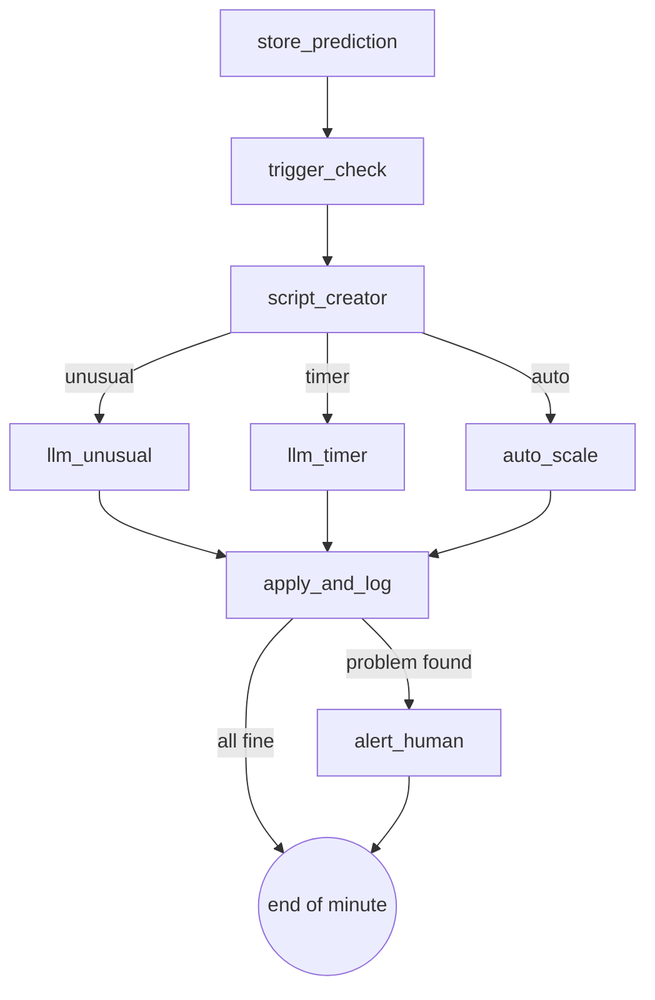

# AegisCloud

**An agentic autoscaler for containerized apps.** An LSTM forecasts traffic 10 minutes ahead. A LangGraph agent runs once per minute, stores the forecast, builds a short report, and decides how many replicas to run. Plain code handles most minutes. An LLM is called only on a timer or when something unusual happens. When something is really wrong, the LLM writes an urgent email to a human with the last hour of logs.

> **Status (24 Oct 2026):** the forecaster is built and evaluated. The LangGraph agent now runs end to end with the **real LSTM, the real dataset and the real Gemini API** (a 134-minute replay is saved in `agent/data/`). Alert emails can be sent through Gmail. The agent is **not** yet compared with a rule-based autoscaler, the simulator and dashboard are **not built yet**, and `set_replicas()` is still a placeholder. See [Roadmap](#roadmap).

---

## Why this project

Rule-based autoscalers (CPU above 70%, target tracking) react after traffic has already grown. A new replica takes about 2 minutes to start, so acting early matters. They also cannot explain what is happening, stop a runaway scale-up caused by a bug, or ask a human for help.

AegisCloud splits the work:

| Part | Job | LLM? |
|---|---|---|
| Forecaster (LSTM) | Predicts traffic 10 minutes ahead | No |
| `auto_scale` | Plain formula, runs on most minutes | No |
| LLM governor (`llm_timer`, `llm_unusual`) | Reads a report of the last 10 minutes, checks the situation, fixes the replica count | Yes, rarely |
| Guardrail | Limits every decision, whoever made it | No |
| `alert_human` | LLM writes an urgent email with the last hour of logs | Yes, only when something is wrong |

The LLM is never called per request and never on every minute.

---

## How the agent works



One pass through the graph is one "minute". `agent/run.py` replays the dataset one row per minute.

| Node | What it does |
|---|---|
| `store_prediction` | Gets this minute's traffic, runs the LSTM for the forecast at +10 min, appends one row to `data/predictions.csv` |
| `trigger_check` | Picks the mode. Priority: **unusual > timer > auto** |
| `script_creator` | Writes a text report of the last 10 minutes: actual traffic, what was predicted earlier for that minute, the error, the new forecast, replicas, and the last 3 actions |
| `llm_unusual` | LLM call because something unusual happened |
| `llm_timer` | LLM call because the timer is due |
| `auto_scale` | No LLM. Scales up at once, scales down only when the last 10 minutes all needed fewer replicas |
| `apply_and_log` | Runs the guardrail, sets replicas, writes `data/actions.csv`, decides whether an alert is needed |
| `alert_human` | Only if something is wrong. The LLM writes the email, it is saved in `data/alerts/` and sent if email is enabled |

### The three modes (decided in plain code)

| Mode | When | Default |
|---|---|---|
| `unusual` | Forecast jumps more than 30% in one minute (and is above 50% of capacity), or forecast or traffic is above 95% of capacity, or forecast error over the last 5 minutes is above 50% | cooldown 3 min |
| `timer` | Every N minutes since the last LLM check. An unusual call resets the timer | every 5 min |
| `auto` | Everything else | |

### Guardrail

Applied to every decision, LLM or auto: replicas stay between min and max, a single decision can at most double the replicas (always +2 allowed) and at most remove 25% (always -1 allowed). The LLM answer is also checked: it must be a JSON object with a numeric `replicas`. If the LLM times out, has no key, or returns garbage, the agent holds the current replicas and records the error.

### Alerts

An alert fires when:

1. the LLM sets `"escalate": true` (scaling cannot fix it: attack-like traffic, a bug, unreliable forecasts),
2. the LLM call failed **2 times in a row** (`LLM_FAILURES_BEFORE_ALERT`; one busy-server error is not an emergency),
3. traffic was above capacity for 5 minutes in a row, or
4. replicas are at the maximum and traffic is still above capacity.

A 30-minute cooldown prevents email spam. The email is written by the LLM from the last 60 minutes of data and may only use numbers from that report. If the LLM cannot write it, a plain-code version is used, so an alert is never lost. Two CSV files are attached: `last_hour_predictions.csv` and `last_actions.csv`.

### Output files (`agent/data/`, created on each run)

| File | Content |
|---|---|
| `predictions.csv` | `minute, traffic_now, forecast, forecast_for, replicas`, one row per minute |
| `actions.csv` | `minute, mode, reason, traffic_now, forecast, replicas_before, proposed, applied, action, decision_reason`, one row per LLM call or replica change |
| `alerts/alert_<minute>.txt` | Every urgent email, including its send status |

---

## Repository layout

```
Major_Project/
  data/dataset.csv          Azure Functions per-minute traffic, 318 apps (large, do not open in an editor)
  models/                   one LSTM per app (app_1, app_62, app_123, app_185, app_248, app_318) + meta.json
  notebook/
    lstm_model.ipynb        data exploration and forecaster comparison
    predict.py              loads a model and predicts traffic 10 minutes ahead
    notebook_readme.md
  agent/                    the LangGraph agent
    config.py               every setting in one place
    state.py                the dictionary passed between nodes
    llm.py                  fake / Gemini / Mistral, retries, fallback model, reply checking, alert email writer
    mailer.py               SMTP email sender
    nodes.py                the 8 nodes
    graph.py                the wiring
    run.py                  start here
    .env.example            copy to agent/.env and fill in your keys
    README.md               how the agent works, in detail
  test/
    llm_tester.py           checks llm.py alone (decision + alert email text)
    graph_tester.py         runs the real graph for 12 minutes and checks everything (30 checks)
  learning/learn_agent.md   the agent explained file by file, for beginners
  Reaserch_Papers/          papers used for the project
  requirements.txt          all dependencies (notebook, forecaster and agent)
```

`src/live_simulator.py` (the future simulator) does not exist yet.

---

## Quick start

Commands are for the project root (`Major_Project/`). On Windows use PowerShell.

**1. Install**

```bash
pip install -r requirements.txt        # or: uv pip install -r requirements.txt
```

**2. Check the forecaster alone** (expect WAPE close to 0.027)

```bash
python notebook/predict.py --app app_62 --backtest
```

**3. Check the LLM layer alone** (nothing is saved, no email is sent)

```bash
python test/llm_tester.py --provider fake       # no internet, no key
python test/llm_tester.py --provider gemini     # needs the key in agent/.env
```

**4. Check the whole graph** (real LSTM, real data, 12 minutes, writes only to `test/output/`)

```bash
python test/graph_tester.py                          # fake LLM:  28 checks
python test/graph_tester.py --provider gemini        # real LLM:  29 checks
python test/graph_tester.py --provider gemini --send-email   # also sends ONE real email: 30 checks
```

Every line must say `[PASS]`. The exit code is 0 when all checks pass.

**5. Run the agent**

```bash
python agent/run.py --minutes 120 --tick 0                            # fake LLM, free
python agent/run.py --provider gemini --timer 3 --minutes 60 --quiet  # real LLM
python agent/run.py --provider mistral
python agent/run.py --provider gemini --email                         # also send alert emails
```

**6. Keys and email.** Copy `agent/.env.example` to `agent/.env` and fill in what you need:

```
GEMINI_API_KEY=...
MISTRAL_API_KEY=...
EMAIL_SENDER=your_address@gmail.com
EMAIL_PASSWORD=your16characterapppassword
EMAIL_TO=person_to_alert@example.com
```

For Gmail, turn on 2-Step Verification and create an app password (your normal password will not work). Write the app password **without spaces**. If email is on but a setting is missing, the agent warns you and saves the alerts as files only. Never commit `.env`.

### `run.py` options

| Option | Meaning |
|---|---|
| `--minutes N` | Replay N minutes (default: until the data ends) |
| `--tick S` | Seconds between minutes (default 1, `0` = as fast as possible) |
| `--timer N` | Minutes between normal LLM checks (default 5) |
| `--app app_1` | Which app to replay (needs a model file for it) |
| `--provider` | `fake`, `gemini` or `mistral` |
| `--email` | Really send alert emails |
| `--quiet` | Print only minutes with an LLM call, a replica change or an alert |

`Ctrl+C` stops safely. The CSV files are already written and a summary is printed.

### Settings (`agent/config.py`)

All tuning is in this one file: replay start (70% point of the data), capacity per replica (computed so the average training load needs 5 replicas), timer, the three "unusual" thresholds, guardrail limits, alert rules, SMTP settings and LLM settings. Gemini uses `GEMINI_MODEL` first and `GEMINI_FALLBACK_MODEL` automatically if the first one fails; busy-server errors (429/5xx) are retried `LLM_RETRIES` times first. Mistral uses `mistral-small-latest`. If your key rejects a model name, change it there; the full error text is printed as `LLM ERROR`.

---

## The forecaster

**Task:** at minute `t`, predict traffic at `t + 10`.

**Data:** Azure Functions invocation counts per minute: 20,160 minutes (14 days) for 318 apps. Six apps were modelled, from busy to quiet: `app_1, app_62, app_123, app_185, app_248, app_318`.

**Fair test:** time split 70/30 with no shuffling, features use only the past, every method is scored on the same test minutes (6,038 per app).

**Methods compared:** `naive`, `moving_avg`, `yesterday`, `gbm` (HistGradientBoosting), `gbm_q90`, `lstm` (PyTorch, 60-minute window), `lstm_q90`.

### Results from the notebook (mean over 6 apps)

| Method | WAPE | under_10pct | over_10pct |
|---|---|---|---|
| lstm | **0.189** | 0.068 | 0.139 |
| gbm | 0.191 | 0.069 | 0.144 |
| gbm_q90 | 0.308 | **0.019** | 0.258 |
| moving_avg | 0.356 | 0.064 | 0.174 |
| yesterday | 0.359 | 0.157 | 0.188 |
| naive | 0.361 | 0.102 | 0.109 |
| lstm_q90 | 0.472 | **0.014** | 0.266 |

WAPE is total absolute error divided by total traffic (lower is better). `under_10pct` is the share of minutes predicted more than 10% too low (risk of slowness). `over_10pct` is the share predicted more than 10% too high (wasted cost).

What the numbers say, without overselling:

- **LSTM and GBM are a tie.** The 0.002 gap comes from one bursty app (`app_185`). One seed, 6 apps.
- **Simple baselines win on smooth apps** (`moving_avg` beats both learned models on `app_1` and `app_123`).
- **`app_185` is not solved.** WAPE is near 1.0 for every method.
- WAPE is a forecasting score, not a cost or SLO score. The final choice of forecaster should be decided by a simulator.

Each `.pt` file holds the weights plus scaling values (`mu`, `sd`, `dsd`), `n_static`, `W=60` and `H=10`. Models are **per app**: a new app needs its own training run.

---

## What is tested and what is not

| Item | State |
|---|---|
| Forecaster evaluation | Done in the notebook |
| Agent graph, all 8 nodes, routing, guardrail, CSV outputs | `test/graph_tester.py`, real LSTM and real data, fake and Gemini LLM |
| Real Gemini calls (decision and alert email text) | Working. A 134-minute replay is saved in `agent/data/` |
| Real email through Gmail | A test email was sent with `mailer.send_email`. The forced alert inside `graph_tester.py --send-email` needs a re-run to confirm |
| Mocked failure cases (junk reply, blocked reply, timeout, no key, SMTP failure) | Tested earlier on synthetic data with mocks |
| Real **Mistral** calls | **Not run yet** |
| LLM failure alert (2 failures in a row) | **Not working until `llm_failures` is added to `AgentState`** (see Limitations) |
| Behaviour under a real traffic spike or an overloaded app | **Not tested** |

The thresholds in `config.py` (30% spike, 95% capacity, 50% forecast error) are first guesses and need tuning.

### What the saved real run shows

The 134-minute replay of `app_62` (minutes 14112 to 14245) with Gemini:

- 40 logged decisions: 26 timer calls to the LLM and 14 changes made by the plain formula. No "unusual" event happened.
- The LLM held the replicas 22 times and scaled up 4 times. It never scaled down. All 8 scale-downs and 6 of the 10 scale-ups came from the plain formula.
- Replicas moved between 6 and 8, with 18 changes in 134 minutes. On this smooth app, the LLM mostly confirmed what the formula would do. Whether it adds value on harder traffic is not measured yet.

---

## Roadmap

| Step | Status |
|---|---|
| Data exploration, baselines, GBM and LSTM forecasters | Done |
| LangGraph agent: store, trigger, script, three branches, guardrail, logging, alert email | Done |
| Real run: real model, real data, real Gemini, retries and fallback model | Done (one app, one replay) |
| Test scripts for the LLM layer and the whole graph | Done |
| Fix the `llm_failures` state bug, tune thresholds, try Mistral | Next |
| Prometheus metrics and Grafana dashboard | To do |
| Connect `set_replicas()` to Docker or Kubernetes | To do |
| Simulator with a 2-minute replica start-up delay, SLO-miss and replica-minute metrics | To do (`src/live_simulator.py` does not exist yet) |
| Compare policies: threshold rule, target tracking, forecast + schedule, forecast + agent | To do |
| Unit tests, CI, deployment, demo video | To do |

## Limitations

- Only 6 of 318 apps have models. One seed, one split, 14 days of data.
- `set_replicas()` is a placeholder. In the replay, new replicas count as instant, so the "minutes above capacity" number in the run summary is optimistic.
- The agent is not yet compared against a rule-based controller. Its added value over plain rules is not measured. If a simulator shows it only matches the rules, that should be reported as is.
- **Known bug:** `llm_failures` is written by `apply_and_log` but is not declared in `AgentState`. LangGraph silently drops undeclared keys, so the failure counter restarts every minute and the "LLM failed 2 times in a row" alert can never fire. Fix: add `llm_failures: int` to `AgentState` in `state.py`.
- `nodes.py` contains the `force_alert` test check twice, and one comment mentions a `--test-alert` option that `run.py` does not have. `config.py` has `SMTP_PORT_STARTTLS`, but `mailer.py` does not use it yet. Clean these up.
- Every minute the graph re-reads `predictions.csv` several times. This is fine for a replay but must change for a live loop.
- **Design change from the first plan:** the early plan had the LLM only adjust one safety setting (headroom). In the current agent the LLM proposes a replica count, bounded by the guardrail. This is easier to explain but gives the LLM more influence, so the guardrail and the alert rules matter.
- The replayed data is history, so scaling decisions cannot change user behavior.
- This is a student portfolio project, not a production autoscaler.

## License

See the `LICENSE` file.