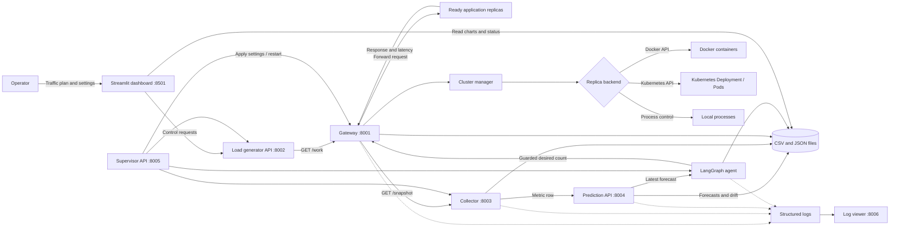
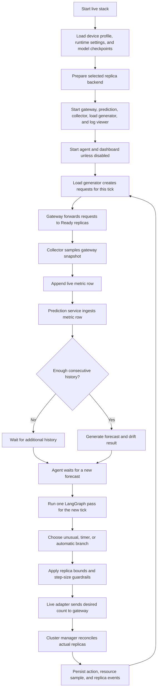
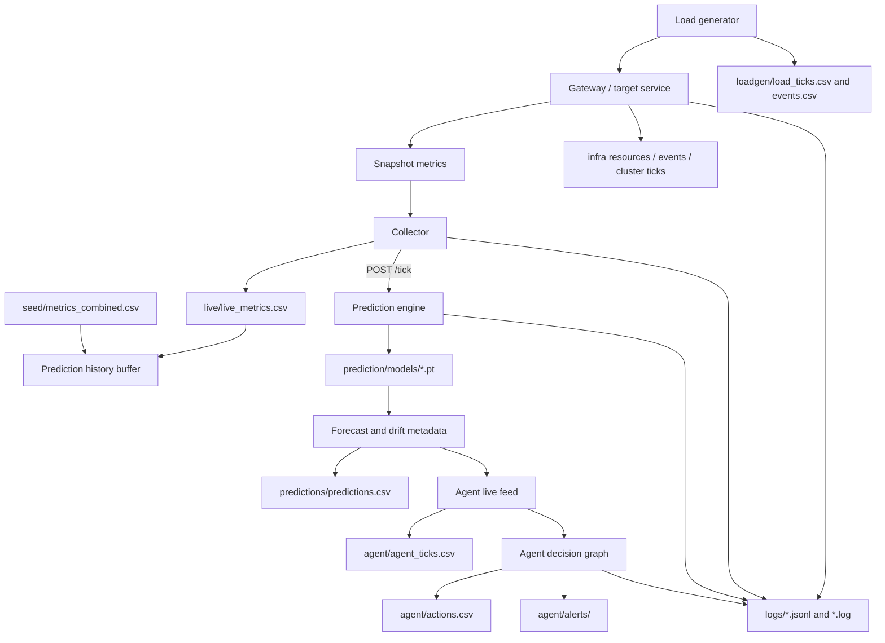
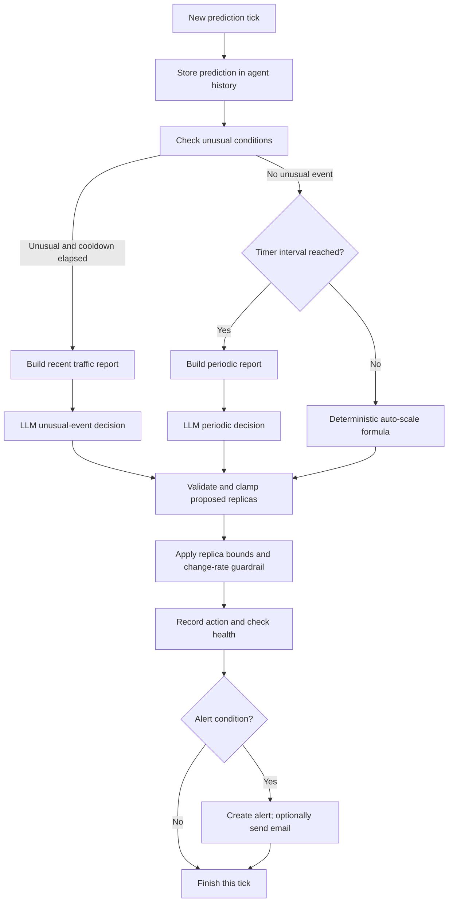
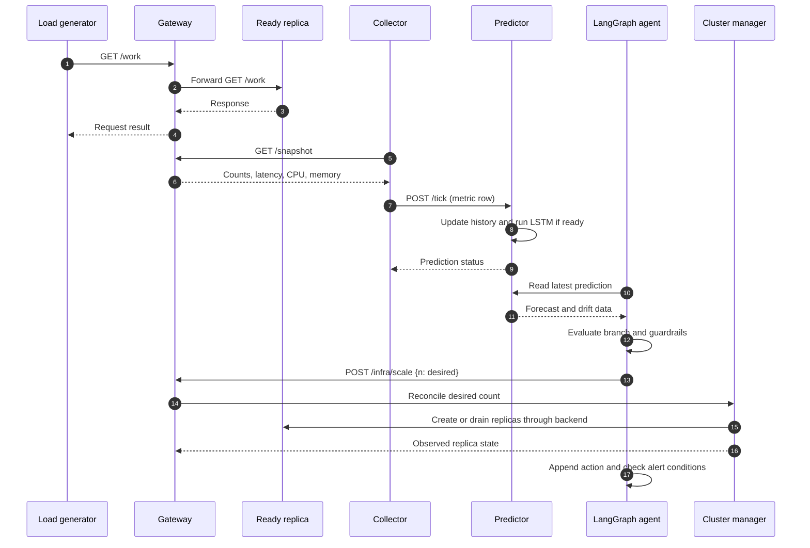
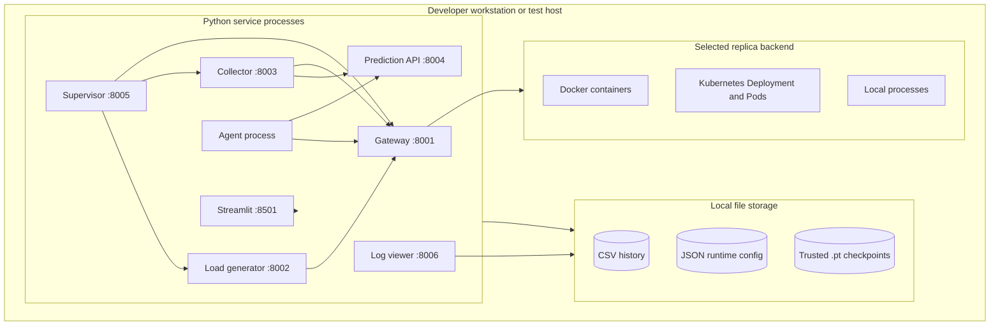

# AegisCloud — Predictive, Agent-Assisted Cloud Resource Allocation

AegisCloud is a research-oriented system for experimenting with **workload forecasting, policy-driven replica scaling, and resource-aware deployment**. Its current implementation combines a PyTorch LSTM forecaster, a LangGraph decision workflow, a FastAPI telemetry and control plane, and a Streamlit operations dashboard. The live runner can manage real demo-application replicas through Docker, Kubernetes, or local processes.

> **Repository layout:** the active implementation is in [`aegiscloud_live/`](aegiscloud_live/). Run its commands from that directory. The other top-level directories are earlier prototypes, research documents, and development archives; they are not separate services required by the live runtime.

> **Project status:** this is an experimental/demo platform, not a drop-in production autoscaler for arbitrary cloud applications. The live path manages replicas of the included demo service. Authentication, multi-tenant isolation, durable database storage, and direct integrations with managed public-cloud control planes are not implemented.

---

## Contents

- [1. Overview](#1-overview)
- [2. Problem and approach](#2-problem-and-approach)
- [3. Capabilities](#3-capabilities)
- [4. Architecture](#4-architecture)
  - [High-level architecture](#high-level-architecture)
  - [End-to-end workflow](#end-to-end-workflow)
  - [Data flow and persistence](#data-flow-and-persistence)
  - [Agent decision process](#agent-decision-process)
  - [Live-run sequence](#live-run-sequence)
  - [Deployment topology](#deployment-topology)
- [5. How the forecasting and scaling logic works](#5-how-the-forecasting-and-scaling-logic-works)
- [6. Technology stack](#6-technology-stack)
- [7. Repository structure](#7-repository-structure)
- [8. Installation and configuration](#8-installation-and-configuration)
- [9. Run AegisCloud](#9-run-aegiscloud)
- [10. Usage and API reference](#10-usage-and-api-reference)
- [11. Data, models, and experiment workflow](#11-data-models-and-experiment-workflow)
- [12. Deployment options](#12-deployment-options)
- [13. Monitoring and observability](#13-monitoring-and-observability)
- [14. Who can use it](#14-who-can-use-it)
- [15. Example scenarios](#15-example-scenarios)
- [16. Security and reliability considerations](#16-security-and-reliability-considerations)
- [17. Testing](#17-testing)
- [18. Troubleshooting](#18-troubleshooting)
- [19. Current limitations](#19-current-limitations)
- [20. Future development](#20-future-development)
- [21. Contributing](#21-contributing)
- [22. License](#22-license)
- [23. Related project material](#23-related-project-material)

---

## 1. Overview

### In simple terms

Imagine an application that receives different amounts of traffic throughout the day. Keeping too many copies of that application running can waste computing resources; running too few can increase waiting time and cause failed requests.

AegisCloud is a controlled environment for testing how an application might respond to changing demand. It generates or replays requests, measures what happened, estimates upcoming request volume, and asks a scaling agent whether the number of application replicas should change. A dashboard shows traffic, predictions, latency, resource usage, and scaling events.

### Technical overview

The live implementation is composed of independently started local services:

1. A **load generator** sends synthetic or replayed requests to a gateway.
2. The **gateway** routes requests to Ready replicas and measures end-to-end request outcomes.
3. A **collector** periodically records request and resource metrics.
4. A **prediction service** preprocesses recent metric history and runs one or more saved LSTM checkpoints.
5. A **LangGraph agent** evaluates new predictions and current health, then proposes a replica count.
6. A **replica manager** reconciles the requested count with actual Docker containers, Kubernetes Pods, or local processes.
7. A **Streamlit dashboard** displays the system and exposes operational controls.
8. A **log viewer** displays structured application logs and grouped problems.

The live route is started with `python run_live.py` from `aegiscloud_live/`. The older `python run_all.py` route remains available for the earlier simulation stack; its replica-setting node is a placeholder and does **not** create real replicas.

## 2. Problem and approach

### The problem

Reactive scaling decisions commonly rely on a metric crossing a threshold after demand has already increased. That can be too late when new replicas have a non-zero startup time. Conversely, scaling up too aggressively or retaining excess capacity can consume resources unnecessarily.

AegisCloud provides a small, inspectable environment in which these trade-offs can be explored using a repeatable workload, measured request outcomes, a forecasting model, and an explicit decision workflow.

### The approach implemented here

- Generate traffic using fixed, random, daily-pattern, idle, or seed-replay plans.
- Measure requests, successful responses, errors, latency percentiles, achieved throughput, CPU, and memory.
- Forecast future request volume from a rolling sequence of eight metrics.
- Use a LangGraph workflow to select between an unusual-event LLM branch, a periodic LLM branch, and a deterministic automatic-scaling branch.
- Apply code-level guardrails to every proposed replica count.
- In live mode, send the guarded desired count to the replica manager, which creates, waits for, drains, and removes replicas through the selected backend.
- Record decisions and observed infrastructure changes so that experiments can be reviewed later.

This is a prototype for **experimentation and demonstration**. Its current target is the bundled demo service, not an arbitrary production workload.

## 3. Capabilities

| Capability | Implemented behavior |
|---|---|
| Workload generation | `idle`, `fixed`, `random`, `pattern`, and `replay` plans; scheduled traffic segments; a per-tick hard cap |
| Request gateway | Forwards work to the least-busy Ready replica in Docker/process mode; Kubernetes uses its configured Service path |
| Telemetry | Per-tick request counts, successes, errors, p50/p95/p99 latency, achieved RPS, CPU, and memory |
| Forecasting | PyTorch multi-feature LSTM; checkpoints are grouped by their stored forecast horizon |
| Drift indicator | Standardized distance between recent live metrics and checkpoint training statistics |
| Agent workflow | LangGraph graph with anomaly, timer, and deterministic autoscaling branches |
| LLM providers | `fake` default provider, with optional Gemini and Mistral integrations |
| Guardrails | Minimum/maximum replica bounds, bounded scale-up/scale-down steps, cooldowns, and device limits |
| Replica execution | Docker containers, Kubernetes Pods, or local processes |
| Calibration | Measures a replica's sustainable request rate against a configured p95 latency goal and error threshold |
| Dashboard | Live, Cluster, Device & Timer, Control, Agent, and Data tabs |
| Logs | JSON Lines logs, raw console logs, a web viewer, and a terminal tail option |
| Experiments | Scripts for static, reactive, HPA-style, and Aegis policy runs |

Features not listed as implemented—such as public-cloud account provisioning, production authentication, tenant management, or an operator-grade SLO controller—should be treated as future work.

## 4. Architecture

### High-level architecture

The following diagram describes the **live mode** (`run_live.py`). The `run_all.py` simulation mode is intentionally not shown as if it had the same replica-management behavior.



### End-to-end workflow



### Data flow and persistence

There is no relational or document database in the current implementation. The services exchange HTTP/JSON and persist operational history primarily as CSV and JSON files under `aegiscloud_live/data/`.



| Location | Written by | Purpose |
|---|---|---|
| `data/seed/metrics_combined.csv` | Supplied dataset / user | Historical warm-up and replay profile; the included file is synthetic (see [Data, models, and experiment workflow](#11-data-models-and-experiment-workflow)) |
| `data/live/live_metrics.csv` | Collector | One row per live collection tick |
| `data/predictions/predictions.csv` | Prediction service | Forecast values, horizon information, source history, and drift information |
| `data/agent/agent_ticks.csv` | Agent | Per-tick input and current replica state |
| `data/agent/actions.csv` | Agent | Proposed and applied decisions with reasons |
| `data/agent/alerts/` | Agent / mailer | Saved alert text files |
| `data/loadgen/load_ticks.csv`, `events.csv` | Load generator | Planned traffic, sent work, and schedule events |
| `data/infra/device_profile.json`, `runtime.json`, `calibration.json` | Infra manager / dashboard | Device assumptions, active runtime values, and measured capacity |
| `data/infra/resources.csv`, `replica_events.csv`, `cluster_ticks.csv` | Infra manager / gateway | Replica CPU/memory samples, lifecycle events, desired/ready counts, and request outcomes |
| `data/logs/` | Services | Structured JSONL and raw console logs |

The `minute` index continues from seed history where available, keeping the model's time-of-day features aligned across warm-up and live data. Existing state files in the archive are example/workspace state, not universal defaults for every machine.

### Agent decision process



The graph in `agent/graph.py` wires eight nodes: `store_prediction`, `trigger_check`, `script_creator`, `llm_unusual`, `llm_timer`, `auto_scale`, `apply_and_log`, and `alert_human`. The LLM is **not** called on every tick: the automatic branch is deterministic. LLM output is subject to code-level bounds before it can affect the desired count. The live wrapper replaces the placeholder scaling function with an HTTP request to the gateway; the original simulation runner does not.

### Live-run sequence



### Deployment topology



`run_live.py` binds the local APIs to `127.0.0.1` by default. Docker, Kubernetes, and process modes are alternatives; only one is selected for a live run. Kubernetes resources are created/reconciled by the backend code, with reference manifests under `aegiscloud_live/infra/k8s/`.

## 5. How the forecasting and scaling logic works

### Forecast model

The model is implemented in `aegiscloud_live/prediction/lstm_model.py` and served by `prediction/predictor.py` and `prediction/server.py`.

- **Inputs:** eight time-series metrics, in this order: `requests`, `p50_ms`, `p95_ms`, `p99_ms`, `achieved_rps`, `app_cpu_pct`, `host_cpu_pct`, and `app_mem_mb`.
- **Sequence length:** 60 rows (`W = 60`).
- **Daily context:** 1,440 ticks (`DAY = 1440`) plus one row, so a checkpoint needs at least 1,441 consecutive rows before it can produce a forecast.
- **Preprocessing:** clip metric values at zero, apply `log1p`, standardize with statistics stored in each checkpoint, and clip standardized input values to ±12.
- **Static features:** yesterday's request value at the target offset, yesterday's change across the corresponding span, and sine/cosine daily-phase features.
- **Network:** an LSTM with hidden size 64 by default, followed by a two-layer feed-forward head that combines the final LSTM state with the four static features.
- **Target:** the standardized change in log request volume at the checkpoint's horizon. The predictor transforms the output back to request counts.
- **Multiple checkpoints:** checkpoints are grouped by the horizon stored inside them; predictions from checkpoints for the same horizon are averaged in log space.

The runtime discovers `.pt` files recursively below `prediction/models/`. The forecast horizon is read from checkpoint metadata; the implementation supports multiple horizons, but the availability of a particular horizon depends on which compatible checkpoints are present. The archive contains `prediction/models/lstm_requests_forecaster.pt`. A second similarly named checkpoint under `data/predictions/` is not in the model discovery directory and is not loaded from there.

### Decision logic and safeguards

The agent uses three decision paths:

1. **Unusual-event path:** checked first. Current code can treat a forecast jump, near-capacity demand, or sustained recent forecast error as unusual. The branch calls the configured LLM provider for a recommendation.
2. **Timer path:** if no unusual event is selected and the periodic timer is due, the agent prepares a recent report and calls the LLM.
3. **Automatic path:** otherwise, a deterministic formula estimates replicas from recent observed/forecast demand and configured per-replica capacity, adding a margin. It does not call the LLM.

A code-level guardrail applies to every proposed value: it constrains the count to the configured minimum and maximum and limits how far it can change in one decision. The implementation also includes cooldowns and a quiet-period condition before scaling down. Device capacity and backend limits are applied by the live infrastructure layer.

The LLM provider can be `fake`, `gemini`, or `mistral`. The `fake` provider is the default for a run when no provider is specified. If an LLM call fails, the agent records the failure and uses its fallback behavior; it does not remove the code-level scaling bounds. Email alerts use SMTP settings supplied by the operator and are optional.

### Replica management

For live runs, `infra.agent_real` replaces `agent.nodes.set_replicas` with a request to `POST /infra/scale`. The gateway passes the desired count to `ClusterManager`, which reconciles it against the selected backend. The manager observes replica state, checks readiness, samples resource use, and drains replicas before removing them. The agent's desired count and the number of Ready replicas can differ temporarily while a container or Pod starts; this delay is visible in the cluster dashboard and infrastructure CSVs.

For `run_all.py`, `agent.nodes.set_replicas()` remains a placeholder (`pass`). That mode records an agent-side replica number but does not perform real Docker/Kubernetes/process scaling.

## 6. Technology stack

The following table describes technologies found in the active code and configuration. The repository also contains older tools in its archived prototype; these are separated below.

| Area | Technology | Role in AegisCloud |
|---|---|---|
| Language | Python | Services, agent, model, orchestration, and tooling |
| API services | FastAPI, Uvicorn, Pydantic | HTTP APIs, service lifecycle, and request validation |
| HTTP clients | HTTPX, Requests | Internal service communication and optional LLM API calls |
| Data processing | NumPy, Pandas | Metric windows, CSV processing, numerical preprocessing, and experiment analysis |
| Machine learning | PyTorch | LSTM model definition, checkpoint loading, inference, and training |
| Agent orchestration | LangGraph | Branching decision workflow for the autoscaler |
| LLM providers | Gemini API, Mistral API (optional) | Recommendations for unusual and periodic decision branches; `fake` is the default provider |
| Dashboard | Streamlit, Plotly | Interactive operations dashboard and charts |
| Resource metrics | psutil | Host and process CPU/memory measurements |
| Container backend | Docker Engine / Docker SDK | Build and manage isolated demo replicas with CPU and memory limits |
| Kubernetes backend | Kubernetes Python client | Manage the configured Deployment, Service, quota, and Pods |
| Persistence | CSV and JSON files | Runtime state, metric history, actions, events, and logs |
| Observability | Python logging, JSON Lines, custom log viewer | Structured logs, request/problem summaries, and downloadable log views |
| Tests | pytest | Unit and integration-style tests for the modules in `tests/` |
| Paper plots | Matplotlib | Plot generation for experiment results |

### Optional or legacy-only technologies

- `prometheus_client` is present in the active dependencies and `agent/metrics.py` contains a Prometheus exporter. However, `run_live.py` starts the live agent with `--no-metrics`, so the live runner does not enable that exporter by default.
- Prometheus and Grafana configuration is present under `Major_Project/monitoring/` and `Major_Project/docker-compose.monitoring.yml`. It belongs to the older `Major_Project` prototype and should not be presented as a monitoring stack already wired into `aegiscloud_live/run_live.py`.
- The root and active-app `package-lock.json` files contain empty package maps. The active implementation is Python; no JavaScript application build is defined by these lockfiles.
- No SQL database, ORM, database migration framework, Terraform configuration, or direct AWS/Azure/GCP autoscaling integration is included in the active implementation.

## 7. Repository structure

The uploaded archive contains **355 files and 104 directories below the repository root** (105 directories when the repository root itself is counted). The principal active application is `aegiscloud_live/`, which contains 115 files and 28 nested directories in the uploaded archive. The tree below lists its source and data organization, then accounts for the historical and research material at the repository root.

```text
.
├── README.md                              # This repository-level guide
├── .gitignore
├── package-lock.json                      # Minimal lockfile; no active JS app
├── aegiscloud_live/                       # CURRENT ACTIVE IMPLEMENTATION
│   ├── .dockerignore
│   ├── .gitignore
│   ├── README.md
│   ├── README (1).md
│   ├── README_research.md
│   ├── PROJECT_REPORT.md
│   ├── CHANGES_FIXES.md
│   ├── requirements.txt
│   ├── requirements-infra.txt
│   ├── pytest.ini
│   ├── package-lock.json                  # Empty npm package map
│   ├── run_all.py                         # Earlier simulation runner
│   ├── run_live.py                        # Live replica runner
│   ├── seed.py                            # Seed data loading and profile helpers
│   ├── settings.py                        # Shared paths, ports, timing, and environment settings
│   ├── data.zip                           # Archived run data bundle; not auto-imported
│   ├── agent/
│   │   ├── __init__.py
│   │   ├── config.py
│   │   ├── feed.py
│   │   ├── graph.py
│   │   ├── health.py
│   │   ├── llm.py
│   │   ├── mailer.py
│   │   ├── metrics.py
│   │   ├── nodes.py
│   │   ├── run.py
│   │   ├── state.py
│   │   ├── README.md
│   │   └── .env.example
│   ├── data/
│   │   ├── README.md
│   │   ├── agent/alerts/.gitkeep
│   │   ├── infra/
│   │   │   ├── calibration.json
│   │   │   ├── cluster_ticks.csv
│   │   │   ├── device_profile.json
│   │   │   ├── replica_events.csv
│   │   │   ├── resources.csv
│   │   │   └── runtime.json
│   │   ├── live/.gitkeep
│   │   ├── loadgen/.gitkeep
│   │   ├── logs/.gitkeep
│   │   ├── predictions/
│   │   │   ├── .gitkeep
│   │   │   └── lstm_requests_forecaster (1).pt  # Not loaded from this directory
│   │   └── seed/
│   │       ├── .gitkeep
│   │       └── metrics_combined.csv
│   ├── frontend/
│   │   ├── __init__.py
│   │   ├── app.py
│   │   ├── charts.py
│   │   ├── cluster_tab.py
│   │   ├── data_access.py
│   │   └── .streamlit/config.toml
│   ├── infra/
│   │   ├── README.md
│   │   ├── __init__.py
│   │   ├── agent_real.py
│   │   ├── calibrate.py
│   │   ├── config.py
│   │   ├── device.py
│   │   ├── gateway.py
│   │   ├── manager.py
│   │   ├── replica_app.py
│   │   ├── runtime.py
│   │   ├── backends/
│   │   │   ├── __init__.py
│   │   │   ├── base.py
│   │   │   ├── docker_backend.py
│   │   │   ├── k8s_backend.py
│   │   │   └── process_backend.py
│   │   ├── docker/Dockerfile.replica
│   │   ├── experiments/
│   │   │   ├── __init__.py
│   │   │   ├── plot.py
│   │   │   └── run_experiment.py
│   │   └── k8s/
│   │       ├── aegis.yaml
│   │       └── hpa.yaml
│   ├── obs/
│   │   ├── __init__.py
│   │   ├── log.py
│   │   ├── middleware.py
│   │   ├── problems.py
│   │   ├── rates.py
│   │   ├── store.py
│   │   ├── viewer.py
│   │   └── web.py
│   ├── prediction/
│   │   ├── __init__.py
│   │   ├── engine.py
│   │   ├── lstm_model.py
│   │   ├── predictor.py
│   │   ├── server.py
│   │   ├── models/
│   │   │   ├── .gitkeep
│   │   │   └── lstm_requests_forecaster.pt
│   │   └── training/
│   │       ├── __init__.py
│   │       ├── synthetic.py
│   │       └── train_horizon.py
│   ├── tests/
│   │   ├── __init__.py
│   │   ├── conftest.py
│   │   ├── test_agent.py
│   │   ├── test_fixes.py
│   │   ├── test_infra.py
│   │   ├── test_mailer.py
│   │   ├── test_obs.py
│   │   ├── test_part2.py
│   │   ├── test_prediction.py
│   │   └── test_traffic.py
│   ├── tools/make_demo_assets.py
│   ├── traffic/
│   │   ├── __init__.py
│   │   ├── collector/
│   │   │   ├── __init__.py
│   │   │   └── app.py
│   │   ├── loadgen/
│   │   │   ├── __init__.py
│   │   │   ├── app.py
│   │   │   ├── cli.py
│   │   │   ├── engine.py
│   │   │   └── plans.py
│   │   └── target_app/
│   │       ├── __init__.py
│   │       └── app.py
│   └── ui/
│       ├── __init__.py
│       ├── counter.html
│       ├── counter.py
│       ├── sender.html
│       └── sender.py
├── proto_1/                               # Earlier version of the live pipeline
│   ├── README.md
│   ├── .gitignore
│   ├── requirements.txt
│   ├── pytest.ini
│   ├── run_all.py
│   ├── seed.py
│   ├── settings.py
│   ├── agent/                             # Earlier LangGraph agent copy
│   ├── data/                              # Earlier seed and generated-data layout
│   │   ├── agent/alerts/
│   │   ├── live/
│   │   ├── loadgen/
│   │   ├── predictions/
│   │   └── seed/
│   ├── frontend/.streamlit/
│   ├── prediction/
│   │   ├── models/
│   │   └── training/
│   ├── tests/
│   ├── tools/
│   └── traffic/
│       ├── collector/
│       ├── loadgen/
│       └── target_app/
├── Major_Project/                          # Earlier standalone research prototype
│   ├── README.md
│   ├── LICENSE                             # License file present only in this subproject
│   ├── requirements.txt
│   ├── monitoring-requirements.txt
│   ├── docker-compose.monitoring.yml
│   ├── MONITORING.md
│   ├── MONITORING_SETUP.md
│   ├── AegisCloud_Paper_Revision_Plan.txt
│   ├── AegisCloud_Research_Paper_First_Draft.docx
│   ├── aegiscloud_architecture.png
│   ├── Reaserch_Papers/                    # Directory spelling as stored in archive
│   ├── agent/
│   ├── fixes/
│   ├── learning/
│   ├── models/
│   ├── monitoring/
│   │   └── grafana/
│   │       ├── dashboards/
│   │       └── provisioning/
│   │           ├── dashboards/
│   │           └── datasources/
│   ├── notebook/
│   ├── output/
│   └── test/
├── Research Paper/
│   ├── Aegis_Cloud__Agentic_AI_for_Intelligent_Cloud_Resource_Allocation_and_Autoscaling__1_.pdf
│   └── humanized_Aegis_Cloud_IEEE_Paper_Source.zip
└── llm_talks/                              # Project notes, audits, and earlier snapshots
    ├── Numbered project notes (01–05 and 16–24) # Design, data, deployment, and debugging notes
    ├── AegisCloud_Master_Project_Audit*.md
    ├── AegisCloud_Master_Project_Audit_2026-11-02.pdf
    ├── agentic-ai-cloud-allocator-main (4).zip
    ├── screenshots/
    └── agentic-ai-cloud-allocator-main (4)/ # Extracted historical snapshot inside the archive
        └── agentic-ai-cloud-allocator-main/
            ├── Major_Project/               # Archived copy of the older prototype tree
            │   ├── Reaserch_Papers/
            │   ├── agent/
            │   ├── fixes/
            │   ├── learning/
            │   ├── models/
            │   ├── monitoring/grafana/
            │   │   ├── dashboards/
            │   │   └── provisioning/{dashboards,datasources}/
            │   ├── notebook/
            │   ├── output/
            │   └── test/
            └── aegiscloud_live/              # Archived earlier live-project snapshot
                ├── agent/
                ├── data/{agent/alerts,live,loadgen,predictions,seed}/
                ├── frontend/.streamlit/
                ├── prediction/{models,training}/
                ├── tests/
                ├── tools/
                └── traffic/{collector,loadgen,target_app}/
```

### Folder responsibilities in the active application

| Folder / file | Responsibility |
|---|---|
| `agent/` | Live-feed reader, LangGraph graph, decision nodes, LLM adapters, health checks, email alerts, and optional agent metrics |
| `traffic/loadgen/` | Traffic plan definitions, execution engine, HTTP API, and command-line client |
| `traffic/collector/` | Periodic sampling of gateway metrics and delivery to the prediction service |
| `traffic/target_app/` | Demo application used by the simulation runner |
| `infra/` | Live gateway, replica manager, device sizing, calibration, runtime settings, and backend adapters |
| `infra/backends/` | Shared backend interface plus Docker, Kubernetes, and process implementations |
| `infra/docker/`, `infra/k8s/` | Container build definition and Kubernetes reference manifests |
| `infra/experiments/` | Runs and plots policy comparison experiments |
| `prediction/` | LSTM architecture, checkpoint discovery, preprocessing, inference engine, and API |
| `prediction/training/` | Synthetic sample generation and multi-horizon training script |
| `frontend/` | Streamlit dashboard, data access, charts, and cluster/device panels |
| `ui/` | Small HTML interfaces mounted by the gateway and load-generator service |
| `obs/` | Structured logging, request middleware, problem grouping, rate summaries, and log viewer |
| `data/` | Seed input, runtime configuration, and generated CSV/JSON/log output |
| `tests/` | Tests for the agent, prediction, infrastructure, mailer, observability, fixes, and traffic components |
| `tools/` | Demo data/model asset generation helper |

The `proto_1/` directory preserves an earlier iteration before the live infrastructure integration. `Major_Project/` is a separate older prototype with its own agent, notebook, monitoring configuration, tests, and research materials. `llm_talks/` is project history and archived snapshots; it is not imported by the active Python services.

## 8. Installation and configuration

### Prerequisites

- Python **3.10 or later** (the code uses modern Python type syntax; the project does not pin a single Python minor version).
- Git, if cloning from a remote repository.
- Docker Desktop / Docker Engine for the default Docker backend.
- A configured Kubernetes cluster and Kubernetes Python client for `--backend k8s`.
- Enough local resources for the selected per-replica CPU and memory limits. The default device profile in the archive is only a saved example and should be reviewed.

The `process` backend can run without Docker or Kubernetes, but it does not enforce per-replica CPU and memory limits.

### Create an environment

From the repository root, enter the active application directory first:

```bash
cd aegiscloud_live

# Linux / macOS
python3 -m venv .venv
source .venv/bin/activate

# Windows PowerShell
# py -3 -m venv .venv
# .venv\Scripts\Activate.ps1

python -m pip install --upgrade pip
pip install -r requirements.txt
```

For Docker and Kubernetes support, also install the infrastructure extras:

```bash
pip install -r requirements-infra.txt
```

If you only intend to use `--backend process`, the core requirements are sufficient.

### Model and seed data

The archive includes:

- `prediction/models/lstm_requests_forecaster.pt` — the checkpoint discovery directory used by the prediction service.
- `data/seed/metrics_combined.csv` — the sample seed history used for prediction warm-up and request replay.

Check that the model checkpoint exists before starting `run_live.py`. The live runner exits if it cannot find any `.pt` file under `prediction/models/`. The second checkpoint stored in `data/predictions/` is not read by the model loader; copy a trusted checkpoint into `prediction/models/` if you intend to use it.

A valid history needs at least 1,441 consecutive metric rows for this model design. The included seed has 20,160 rows, so the normal bundled demo can warm up immediately. Without seed history, the system must collect enough live rows before forecasts become available.

### Environment variables

`settings.py` centralizes the active runtime settings. Most service variables use the `AEGIS_` prefix.

| Variable | Default | Purpose |
|---|---:|---|
| `AEGIS_DATA_DIR` | `aegiscloud_live/data` | Override the data and runtime-state directory |
| `AEGIS_MODELS_DIR` | `prediction/models` | Override the model checkpoint directory |
| `AEGIS_TICK_SECONDS` | `5` | Real seconds per simulated minute/tick |
| `AEGIS_PORT_TARGET` | `8001` | Gateway in live mode; demo target app in simulation mode |
| `AEGIS_PORT_LOADGEN` | `8002` | Load-generator API |
| `AEGIS_PORT_COLLECTOR` | `8003` | Collector API |
| `AEGIS_PORT_PREDICTION` | `8004` | Prediction API |
| `AEGIS_PORT_FRONTEND` | `8501` | Streamlit dashboard |
| `AEGIS_PORT_SUPERVISOR` | `8005` | Live-run supervisor API |
| `AEGIS_PORT_LOGS` | `8006` | Browser log viewer |
| `AEGIS_MAX_PER_TICK` | `3000` | Maximum requests sent in one tick |
| `AEGIS_LOADGEN_AUTOSTART` | `pattern` | Start with daily-pattern traffic; set to `off` to start idle |
| `AEGIS_SERVICE_MS` | `30` | Demo target service time in milliseconds |
| `AEGIS_CONCURRENCY` | `16` | Demo target concurrent request slots |
| `AEGIS_MAX_QUEUE` | `400` | Demo target waiting queue limit |
| `AEGIS_CPU_BURN_MS` | `2` | Demo target CPU work per request |
| `AEGIS_TARGET_MEM_MB` | `103` | Demo target memory ballast setting |
| `AEGIS_REFRESH_SECONDS` | `5` | Dashboard refresh interval |
| `AEGIS_LOG_LEVEL` | Code default | Logging level |
| `AEGIS_LOG_MAX_MB` | `20` | Log rotation size setting |
| `AEGIS_LOG_BACKUPS` | `5` | Rotated log backup count |
| `AEGIS_K8S_SERVICE_URL` | `http://127.0.0.1:30080` | Kubernetes service URL used by the backend configuration |

The agent's optional integrations read `GEMINI_API_KEY`, `MISTRAL_API_KEY`, `EMAIL_SENDER`, `EMAIL_PASSWORD`, and `EMAIL_TO`. Start from [`aegiscloud_live/agent/.env.example`](aegiscloud_live/agent/.env.example), place your own values in an untracked `.env` file supported by the code, and never commit real credentials. The agent configuration checks the project-level `.env` and `agent/.env`; the agent-local file is loaded with override behavior.

Do not copy API keys or passwords from archived files, screenshots, logs, ZIPs, or example environments. See [Security and reliability considerations](#16-security-and-reliability-considerations) before publishing the repository.

## 9. Run AegisCloud

### Live mode — recommended for replica-management experiments

Start Docker Desktop / Docker Engine first, then from `aegiscloud_live/`:

```bash
python run_live.py
```

The default backend is Docker. On first start, the runner prepares/builds the `aegiscloud-replica:latest` image and starts the local services. Open:

- Dashboard: <http://localhost:8501>
- Request counter: <http://localhost:8001>
- Traffic sender: <http://localhost:8002>
- Log viewer: <http://localhost:8006>

Stop the stack with `Ctrl+C`. The runner stops its services and asks the backend to remove replicas.

Other verified runner options:

```bash
# Local processes; no Docker required, but no per-replica resource limits
python run_live.py --backend process

# Use a configured Kubernetes cluster
python run_live.py --backend k8s

# Change real seconds per simulated minute
python run_live.py --tick 10

# Use the Gemini or Mistral agent provider after setting the relevant key
python run_live.py --provider gemini
python run_live.py --provider mistral

# Run services without the dashboard, or without the agent
python run_live.py --no-frontend
python run_live.py --no-agent --no-frontend
```

The agent defaults to the `fake` provider when `--provider` is omitted. The fake provider is useful for exercising the control flow without sending prompts to an external LLM API.

### Simulation mode — earlier orchestration path

```bash
python run_all.py
```

`run_all.py` starts the older demo target, load generator, collector, prediction service, agent, and dashboard. It is useful for exercising the metric/forecast/agent data path, but its `set_replicas()` implementation is a placeholder. It does not create or terminate actual replicas. Use `run_live.py` when evaluating the Docker, Kubernetes, or process replica backends.

The optional demo-asset path generates artificial seed data and small demonstration checkpoints:

```bash
python run_all.py --demo
```

Do not use the generated demo assets as evidence of real workload performance or model quality.

## 10. Usage and API reference

### Dashboard

The Streamlit dashboard has six tabs:

| Tab | What it displays or controls |
|---|---|
| **Live** | Traffic now, forecast horizons available from loaded models, forecast error versus a naive baseline, latency, CPU, memory, and replica history |
| **Cluster** | Desired/Ready/starting replicas, replica lifecycle events, resource samples, and infrastructure status |
| **Device & Timer** | Device CPU/RAM assumptions, replica limits, tick interval, and calibration/apply controls |
| **Control** | Traffic plan settings and scheduled traffic windows; collector controls where exposed |
| **Agent** | Agent decisions, reasons, alerts, and recent activity |
| **Data** | Recent data and CSV export/inspection controls |

The dashboard is a local development interface, not an authenticated multi-user console.

### Traffic-generator CLI

Run these commands from `aegiscloud_live/` while the load-generator API is running:

```bash
# Inspect active status
python -m traffic.loadgen.cli status

# Send a fixed 300 requests per tick
python -m traffic.loadgen.cli start fixed --n 300

# Choose a random count between 50 and 400 requests per tick
python -m traffic.loadgen.cli start random --lo 50 --hi 400

# Use the training seed's daily profile with scale/noise and occasional bursts
python -m traffic.loadgen.cli start pattern --scale 1.2 --noise 0.25

# Replay the seed request series from row 0
python -m traffic.loadgen.cli start replay --start 0

# Start a fixed-load segment in 60 seconds, lasting 120 seconds
python -m traffic.loadgen.cli schedule --in 60 --duration 120 fixed --n 600

# Stop traffic and cancel scheduled segments
python -m traffic.loadgen.cli stop
```

The plan modes are `idle`, `fixed`, `random`, `pattern`, and `replay`. A plan expresses requests per tick. With the default 5-second tick, 300 requests per tick is a planned average of 60 requests per second over that interval. Actual request completion and achieved throughput are measured, not assumed. The load generator caps the planned count at `AEGIS_MAX_PER_TICK`.

### Service ports and endpoints

The services bind to `127.0.0.1` by default. Routes below are implemented in the active application.

| Port | Service | Main endpoints |
|---:|---|---|
| `8001` | Live gateway (or simulation target app) | `GET /health`, `GET /work`, `GET /snapshot`, `POST /tune`, `GET /` counter page. Live gateway also exposes `POST /infra/scale`, `GET /infra/state`, `GET /infra/events`, `GET /infra/resources`, `GET /infra/device`, `POST /infra/reload`, `POST /infra/calibrate`, `GET /infra/calibrate/status`. |
| `8002` | Load generator | `GET /health`, `GET /status`, `POST /start`, `POST /stop`, `POST /schedule`, `DELETE /schedule/{seg_id}`, `GET /` sender page |
| `8003` | Collector | `GET /health`, `GET /status`, `GET /latest`, `POST /pause`, `POST /resume` |
| `8004` | Prediction service | `GET /health`, `GET /status`, `POST /tick`, `GET /latest`, `POST /reload` |
| `8005` | Live supervisor | `GET /health`, `GET /status`, `POST /apply`, `POST /restart/{name}` |
| `8006` | Log viewer | `GET /health`, `GET /`, `GET /api/logs`, `GET /api/apps`, `GET /api/problems`, `GET /api/download` |
| `8501` | Streamlit dashboard | Dashboard web application |

### Example API requests

Start a fixed traffic plan:

```bash
curl -X POST http://127.0.0.1:8002/start \
  -H "Content-Type: application/json" \
  -d '{"mode":"fixed","n":300}'
```

Inspect the sender state:

```bash
curl http://127.0.0.1:8002/status
```

Pause and resume metric collection:

```bash
curl -X POST http://127.0.0.1:8003/pause
curl -X POST http://127.0.0.1:8003/resume
```

Read the latest prediction:

```bash
curl http://127.0.0.1:8004/latest
```

Ask the live gateway to set a desired replica count (the request is subject to device/backend limits):

```bash
curl -X POST http://127.0.0.1:8001/infra/scale \
  -H "Content-Type: application/json" \
  -d '{"n":4}'
```

The exact prediction response fields depend on the loaded checkpoint horizons. Use `/status` to inspect model readiness and loaded checkpoint information before relying on a particular horizon.

## 11. Data, models, and experiment workflow

### Included seed data

`aegiscloud_live/data/seed/metrics_combined.csv` contains 20,160 rows and a `minute` column plus the eight model metrics. During the repository audit, the supplied file was compared with the output of `prediction.training.synthetic.make_synthetic(20160, 0)`; its values match the checked-in synthetic generator (apart from floating-point representation). It should therefore be described as **synthetic sample data**, not a production trace or independently collected customer workload.

`aegiscloud_live/data.zip` is an additional archived run-data bundle. The application does not automatically extract or import it.

### Train a checkpoint

The training script can build a checkpoint for one or more horizons and seeds. Example from `aegiscloud_live/`:

```bash
python -m prediction.training.train_horizon \
  --data data/seed/metrics_combined.csv \
  --horizons 10 20 \
  --seeds 3 \
  --train-fraction 0.7 \
  --out prediction/models
```

Use a chronological holdout fraction for evaluation. The script's `--train-fraction 1.0` option is intended for final retraining after selecting a model configuration; it does not provide a holdout evaluation. Compare model forecasts with simple baselines such as persistence/naive and moving averages before treating a checkpoint as useful for a specific workload.

### Device calibration

The device profile computes a maximum replica count from usable CPU, usable RAM, per-replica allocation, and a hard limit. It estimates replica capacity from the configured application work, but a calibration can replace that estimate with measured throughput.

The dashboard's Device & Timer tab exposes calibration and apply controls. Calibration uses a separate test replica and progressively increases request rate, retaining the highest tested rate that met the configured p95 latency goal and error threshold. Stop the normal load generator before calibrating so the test has the CPU to itself. The calibration implementation requires direct replica URLs (Docker or process backend); for Kubernetes, calibrate with Docker first and reuse the matching measurement as described in [`aegiscloud_live/infra/README.md`](aegiscloud_live/infra/README.md).

### Policy experiments

`infra/experiments/run_experiment.py` provides `static`, `reactive`, `hpa`, and `aegis` policies. The infrastructure README documents the intended experiment sequence and plot command. For example:

```bash
# Start live services without the Aegis agent and dashboard for baseline runs
python run_live.py --no-agent --no-frontend

python -m infra.experiments.run_experiment --policy static --static-n 3 --reps 3
python -m infra.experiments.run_experiment --policy reactive --reps 3
python -m infra.experiments.run_experiment --policy hpa --reps 3

# Stop the stack, restart with the agent, then run the Aegis policy
python run_live.py --no-frontend
python -m infra.experiments.run_experiment --policy aegis --reps 3
python -m infra.experiments.plot
```

Follow the experiment script's own help and the detailed setup notes in `aegiscloud_live/infra/README.md` before running long tests. These experiments are local research tools; run them on a dedicated test host and record the selected device profile, backend, tick length, and calibration so results can be interpreted.

## 12. Deployment options

### Docker backend

- Default backend for `run_live.py` when no backend is supplied or saved in runtime configuration.
- Builds `aegiscloud-replica:latest` from `infra/docker/Dockerfile.replica` when required.
- Runs demo replicas as containers with configured CPU and memory limits.
- Requires Docker Engine / Docker Desktop and the Docker Python package from `requirements-infra.txt`.

### Process backend

```bash
python run_live.py --backend process
```

Runs the replica application as local processes. It can be useful on a machine without Docker, but **does not enforce CPU or memory limits per replica**. Do not use it to claim isolated resource allocation.

### Kubernetes backend

The backend code provisions a namespace, quota, Deployment, and Service and observes Pods through the Kubernetes API. The repository also contains reference manifests in `infra/k8s/aegis.yaml` and `infra/k8s/hpa.yaml`.

For a local k3d cluster, the documented example is:

```bash
# Create a cluster with the NodePort mapped to the host
k3d cluster create aegis -p "30080:30080@server:0"

# Build the replica image from aegiscloud_live/
docker build -t aegiscloud-replica:latest -f infra/docker/Dockerfile.replica .

# Import the image into k3d
k3d image import aegiscloud-replica:latest -c aegis

# Start AegisCloud using Kubernetes
python run_live.py --backend k8s
```

The Kubernetes cluster and its context must already be available to the Python client. The cluster's metrics-server is used for Pod CPU/memory metrics; Kubernetes metric reporting can be slower than the Docker backend. Calibrate capacity with Docker first because the current calibration path needs direct replica URLs.

These options are local deployment backends. The repository does not include Terraform or cloud-provider API adapters for creating infrastructure in AWS, Azure, or Google Cloud.

## 13. Monitoring and observability

The active application writes per-service log files under `data/logs/`:

- `*.jsonl` structured records for programmatic review and the browser viewer.
- `*.log` raw combined console output for service-level troubleshooting.

Open <http://localhost:8006> while `run_live.py` is running. The log viewer exposes log, application, problem-summary, and download endpoints. For a terminal tail, run:

```bash
python -m obs.viewer --follow
```

The dashboard also exposes live request metrics, forecasts, latency, resource usage, replica lifecycle, and agent actions. Infrastructure events and time-series samples are recorded in `data/infra/`.

**Prometheus/Grafana distinction:** the older `Major_Project/` directory includes Prometheus and Grafana configuration, provisioning, and a dashboard. That setup belongs to the earlier replay-based project and is not started by the active `aegiscloud_live/run_live.py`. Although the active dependencies and agent module include Prometheus client support, the live runner explicitly starts the agent with `--no-metrics`. Do not assume a Prometheus scrape endpoint or Grafana dashboard is part of the current live stack without separately implementing and wiring it.

## 14. Who can use it

The following are **potential users and application areas**, not claims of existing customers or production deployments.

| User / organization | Potential problem | How AegisCloud could help today | Example and practical value | What would be needed for production use |
|---|---|---|---|---|
| Students and educators | Autoscaling concepts are difficult to observe end to end | Demonstrates the relationship between traffic, prediction, decisions, replicas, and latency | Run fixed and burst traffic, compare the dashboard's replica and latency timelines, and inspect agent actions | Curated labs, stable starter environments, and guided assignments |
| AI/ML researchers | Forecast models need to be evaluated in a closed-loop system, not only on offline error | Supplies a live metrics-to-forecast pipeline and can compare forecasts with simple baselines | Train separate horizon checkpoints, replay seed traffic, and inspect prediction error and drift | Larger real workload traces, reproducible benchmark protocol, and statistically repeated evaluations |
| DevOps / SRE teams | Scaling policies can react too late or allocate too much capacity | Provides a test harness for policy and capacity experiments against a controllable demo service | Calibrate one replica, inject a scheduled spike, and compare desired versus Ready replicas and SLO-related metrics | Production service adapters, authentication, durable telemetry, SLO policy validation, and safe rollout controls |
| Startups and small SaaS teams | Limited time and infrastructure to prototype resource policies | Offers a local proof-of-concept for learning about forecast-guided scaling | Use the process backend for a quick walkthrough or Docker for isolated demo replicas | Connect the real service, add secrets management, access controls, persistent storage, and independent load tests |
| Platform engineering groups | Need a repeatable sandbox before adopting an autoscaling design | Allows experiments with Docker and Kubernetes backends and different traffic profiles | Compare static, reactive, HPA-style, and Aegis policy runs in a test cluster | Multi-node testing, cloud-provider integration, security reviews, and operational runbooks |
| Software consultancies / engineering teams | Need a demonstrable prototype when evaluating autoscaling designs for a client | Provides an inspectable reference architecture and demo dashboard | Demonstrate a synthetic traffic spike and show how the policy changes its desired replica count | Client-specific service integration, data governance, and deployment hardening |
| Larger enterprises and public-sector IT teams | Need to evaluate resource policy behavior under controlled conditions | Can serve as an internal learning or sandbox proof-of-concept | Run experiments against the included demo service without touching a production workload | Formal security, compliance, identity, audit, high availability, multi-tenancy, and approved infrastructure integrations |

## 15. Example scenarios

### Scenario A — A SaaS team rehearses a traffic spike

**Situation:** A small engineering team expects a burst around a product announcement and wants to understand how replica startup time affects service latency.

**Workflow:** The team starts `run_live.py` with Docker, calibrates capacity for the selected device profile, selects a daily-pattern plan, and schedules a higher fixed-load segment. The gateway records outcomes while the collector and prediction service produce the forecast history.

**Output:** The dashboard shows request volume, p95 latency, errors, desired/Ready replicas, startup events, and the agent's actions. The team can compare the time the agent requested more replicas with the time the new replicas became Ready.

**Value:** This makes startup delay and the difference between a desired replica count and an actually Ready replica visible. It is a rehearsal on the bundled demo app—not proof that a company's production service will behave identically.

### Scenario B — A researcher compares scaling policies

**Situation:** A researcher wants to compare a fixed replica count, a threshold/reactive policy, an HPA-style policy implemented by the experiment script, and the Aegis policy on a repeatable traffic shape.

**Workflow:** The researcher records the device settings and calibration, runs the `static`, `reactive`, and `hpa` experiment policies without the agent, then restarts with the agent and runs `aegis`. The experiment scripts record request outcomes, latency, resource use, replica-seconds, and lifecycle timing for plotting. The `hpa` policy emulates an HPA-style CPU-utilization rule in the experiment runner; it is not the built-in Kubernetes HPA controller managing this Deployment.

**Output:** Experiment CSVs and plots summarize the measured behavior for the selected test configuration.

**Value:** It provides a common harness for controlled comparison. Results must be repeated and interpreted with the synthetic workload, selected backend, machine limits, and model's forecast error in mind.

### Scenario C — A student explores the forecast-to-action chain

**Situation:** A student understands LSTMs and APIs separately but wants to see how a prediction influences a control loop.

**Workflow:** The student starts the stack, uses `python -m traffic.loadgen.cli start fixed --n 300`, checks `/status` and `/latest`, and views the Live and Agent dashboard tabs. They then switch traffic to random or replay mode and compare the next decisions.

**Output:** CSV rows link the metric tick, forecast, agent branch, decision reason, and replica action.

**Value:** The architecture makes an end-to-end AI/automation workflow inspectable, including cases where the automatic formula runs without an LLM call.

### Scenario D — A platform team measures per-replica capacity

**Situation:** A team needs an estimate of how many requests a single demo replica can handle under a chosen CPU/memory share and latency target.

**Workflow:** The team stops normal traffic, opens Device & Timer, reviews the device profile and p95 target, runs calibration, and applies the saved result. The runtime file then carries the selected capacity and its source (`calibrated` or `estimated`) to the agent wrapper.

**Output:** The calibration JSON contains tested rates and the best rate meeting its configured conditions. The dashboard and agent use capacity per tick based on that measurement.

**Value:** The policy can size replica requests using measured local capacity instead of relying only on a rough CPU-work estimate. The measurement is specific to the tested machine, backend, app weight, and replica resource allocation.

## 16. Security and reliability considerations

This repository is suitable for a controlled development environment. Review the following before exposing any service or publishing the full archive.

### Credentials and archived material

- Never commit `.env` files, API keys, SMTP passwords, access tokens, or real service credentials.
- The uploaded archive contains a **nested credential-bearing archive chain**: `llm_talks/agentic-ai-cloud-allocator-main (4).zip` contains `Major_Project/agent.zip`, and that inner ZIP contains a populated `agent/.env` with credential entries. The README does not reproduce those values. Before publishing, remove the affected nested archive(s) or rebuild them after sanitizing the embedded `.env`; rotate any real Gemini key, email/app password, and Grafana password that may have been present.
- Search all nested ZIPs, notebooks, logs, screenshots, and historical project copies for secrets before making the repository public. A root `.gitignore` does not remove secrets that are already present inside a tracked archive.
- Use `agent/.env.example` only as a variable-name reference. Supply your own secrets through untracked local files or a secret manager.

### Network exposure and access control

- The active services bind to `127.0.0.1` by default, but the APIs do not implement user authentication or authorization.
- Do not bind these APIs to a public interface or expose them through an internet-facing reverse proxy without adding authentication, authorization, TLS, request validation, and network controls.
- The replica and supervisor control endpoints can change running workloads. Keep them restricted to a trusted local environment.

### Model and data trust

- The current predictor loads `.pt` checkpoints using `torch.load(..., weights_only=False)` because its checkpoint includes NumPy metadata. This can execute pickle payloads during loading. **Only load checkpoints from a source you trust.** Consider migrating the checkpoint format to a safer, validated artifact format before accepting third-party models.
- Treat uploaded traffic traces and archived runtime JSON as untrusted input. Review their provenance before using them in experiments.
- The bundled seed file is synthetic and should not be represented as customer or production telemetry.

### Reliability and failure behavior

- The live gateway returns HTTP 503 when no replica is Ready or a replica request fails; these failures are counted in gateway snapshots.
- New containers/Pods take time to become Ready. Agent decisions track desired replicas, while infrastructure telemetry reports actual readiness and startup events.
- The process backend does not enforce CPU or memory quotas.
- LLM calls and email delivery depend on external provider/SMTP availability and correctly configured credentials. The agent has fallback behavior for LLM failures, but external integrations are not guaranteed to be available.
- CSV/JSON persistence is simple and inspectable, but it is not a substitute for a transactional database or a multi-writer time-series store.
- No high-availability, disaster-recovery, multi-tenant isolation, or production SLO guarantee is provided.

## 17. Testing

The active test suite is under `aegiscloud_live/tests/` and includes tests for:

- Agent graph and decision behavior (`test_agent.py`, `test_fixes.py`)
- Replica infrastructure and backends (`test_infra.py`)
- Mail notifications (`test_mailer.py`)
- Logging and observability (`test_obs.py`)
- Additional cross-component behavior (`test_part2.py`)
- Forecasting (`test_prediction.py`)
- Traffic collection and generation (`test_traffic.py`)

Run from `aegiscloud_live/` after installing `requirements.txt`:

```bash
python -m pytest
```

The repository's earlier documentation reports historical test runs, but those reports are not a substitute for running the suite against the exact environment and commit being evaluated. In this audit environment, test collection could not complete because the `langgraph` dependency was not installed; install the declared requirements and rerun the command to obtain a current result.

## 18. Troubleshooting

| Symptom | Checks and remedies |
|---|---|
| `run_live.py` exits saying no `.pt` model exists | Verify that a trusted `.pt` checkpoint is under `aegiscloud_live/prediction/models/`. A similarly named file under `data/predictions/` is not searched. |
| Docker backend cannot start | Start Docker Desktop / Engine, confirm the active context, install `requirements-infra.txt`, and inspect `data/logs/gateway.log` or runner output. |
| Kubernetes backend cannot connect | Confirm the cluster is running and the expected kubeconfig context is selected; ensure the Kubernetes Python dependency is installed and required image/NodePort setup is complete. |
| Process backend works but replicas are not CPU/memory isolated | This is expected; the process backend has no per-replica resource limits. Use Docker or Kubernetes for isolation experiments. |
| Forecast service reports insufficient history | Check that the seed CSV is present and contains the required `minute` and eight metric columns, or collect at least 1,441 consecutive rows. |
| Forecast horizon is missing | Inspect `GET /status` on port 8004. Only horizons present in loaded checkpoint metadata are available. Train or add a compatible checkpoint for the missing horizon. |
| Forecasts look unreliable | Review the dashboard's drift warning, input units, sampling interval, seed provenance, and comparison with naive/moving-average baselines. |
| Agent does not change real replica count | Confirm you started `run_live.py`, not `run_all.py`; inspect the gateway's `/infra/state`, `data/infra/replica_events.csv`, and `data/logs/agent.log` / `gateway.log`. |
| No Gemini/Mistral response | Confirm the correct key is configured in an untracked `.env`, select the matching `--provider`, and review agent logs. The default provider is `fake`. |
| Email alert is not delivered | Check SMTP sender, app password, recipient, Gmail/security policy, network connectivity, and the saved alert file under `data/agent/alerts/`. |
| Port already in use | Change the corresponding `AEGIS_PORT_*` variable and ensure all services use the same port configuration. |
| Dashboard appears stale | Check service health/status endpoints, collector pause state, prediction readiness, and `AEGIS_REFRESH_SECONDS`. |

## 19. Current limitations

The following limitations are visible from the implementation and the supplied project material:

1. **Demo application scope:** the included target/replica app is a synthetic service. No generic adapter for an external production application is included.
2. **No public-cloud provisioning:** the live backends are Docker, Kubernetes, and local processes. There are no AWS, Azure, or GCP control-plane adapters or Terraform modules.
3. **Simulation runner does not scale real infrastructure:** `run_all.py` retains a placeholder `set_replicas()` function. Use `run_live.py` for actual backend operations.
4. **Forecast quality is not established:** the included seed is synthetic, and research notes discuss baseline comparisons and the need for further policy evaluation. Do not claim that the LSTM outperforms naive or moving-average forecasts without a current, reproducible evaluation.
5. **Checkpoint horizon depends on the artifact:** the code supports multiple horizons, but checkpoint metadata determines which forecasts are available. Validate each checkpoint before relying on a horizon.
6. **Model checkpoint trust:** the loader uses pickle-based loading with `weights_only=False`; untrusted checkpoints are unsafe.
7. **Agent readiness model:** the agent's decision state represents a desired replica count; the infrastructure layer exposes real startup and readiness delays separately. This difference matters when evaluating response latency.
8. **Process backend isolation:** process replicas have no enforceable per-replica CPU/memory quotas.
9. **Persistence:** CSV and JSON files are local, not transactional, and are not designed for multi-host concurrent operation or large-scale retention.
10. **Security and operations:** no API authentication/authorization, role-based access, tenant isolation, managed secrets integration, or high-availability control plane is implemented.
11. **Prometheus/Grafana wiring:** the Prometheus/Grafana configuration in `Major_Project/` belongs to the older prototype; it is not connected to the current live runner by default.
12. **Research material is mixed with source snapshots:** the uploaded repository contains earlier implementations, nested copies, paper drafts, and development notes. Those files are useful for provenance but can confuse a new contributor unless the active entry point is kept clear.

## 20. Future development

The following are proposals, not existing features:

- Add a workload adapter interface so the gateway/manager can control a user-supplied service with configurable health checks and routing.
- Add authentication, authorization, TLS termination, request audit trails, and a secrets-manager integration before any network exposure.
- Move high-volume telemetry and decision history from local CSV files to a durable database or time-series store with retention and concurrency controls.
- Evaluate forecasting models with chronological splits, walk-forward evaluation, naive and seasonal baselines, multiple random seeds, and multiple real workload traces.
- Add safe checkpoint serialization, artifact provenance, hashes/signatures, and explicit schema validation.
- Add automated retraining and drift-response workflows, with model promotion gated by evaluation metrics.
- Improve agent policy evaluation by accounting for replica startup delay, warm-up, cooldown, queue depth, and uncertainty in forecast intervals.
- Wire Prometheus metrics and Grafana dashboards into the current live runner, or document a supported exporter configuration for each service.
- Add multi-node Kubernetes tests and explicit compatibility checks for managed Kubernetes distributions.
- Build direct cloud-provider integrations only after a permissions model, safety boundary, and cost-control design are in place.
- Expand tests with fault injection for backend outages, slow startup, LLM timeouts, missing history, corrupted checkpoint metadata, and concurrent API use.

## 21. Contributing

Contributions should preserve the distinction between the active live implementation and historical snapshots.

1. Create a branch for the change.
2. Make application changes under `aegiscloud_live/` unless the work explicitly targets an archived prototype or research artifact.
3. Add or update tests under `aegiscloud_live/tests/`.
4. Run `python -m pytest` from `aegiscloud_live/` and record any environment-specific skips or failures.
5. Update this README and the relevant module-level documentation when behavior, setup, API routes, or configuration changes.
6. Never include credentials, private traffic traces, unreviewed model checkpoints, or large generated output in a change.

For architectural changes, include a short rationale, a reproducible command or test, and an updated Mermaid diagram where the system flow changes.

## 22. License

There is no top-level `LICENSE` file in the uploaded repository. `Major_Project/LICENSE` exists inside the historical `Major_Project/` subproject only; its presence does not automatically establish the license for the root repository or the active `aegiscloud_live/` application.

Before publishing or accepting external contributions, the repository owner should choose and add an explicit license for the root project and confirm the licensing/provenance of research papers, datasets, model checkpoints, images, and archived material.

## 23. Related project material

The active application includes its own supporting documentation:

- [`aegiscloud_live/README.md`](aegiscloud_live/README.md) — earlier live-project quick start and operating notes.
- [`aegiscloud_live/infra/README.md`](aegiscloud_live/infra/README.md) — live replica backends, Kubernetes setup, calibration, and experiment commands.
- [`aegiscloud_live/agent/README.md`](aegiscloud_live/agent/README.md) — agent data feed and graph overview.
- [`aegiscloud_live/data/README.md`](aegiscloud_live/data/README.md) — generated CSV data layout.
- [`aegiscloud_live/README_research.md`](aegiscloud_live/README_research.md) and [`aegiscloud_live/PROJECT_REPORT.md`](aegiscloud_live/PROJECT_REPORT.md) — research and project-report notes.
- [`Major_Project/README.md`](Major_Project/README.md), `MONITORING.md`, and `MONITORING_SETUP.md` — documentation for the older research prototype, not the current live runner.
- `llm_talks/` — development notes, project audits, and archived snapshots. These are context/history, not required runtime modules.

---

**AegisCloud is best understood as an experimental platform for exploring the complete path from workload generation to forecasting, guarded agent decisions, and observed replica management.** Use the live runner for real local replica experiments, keep the synthetic-data and security limitations in view, and validate each model/backend combination before drawing performance conclusions.
