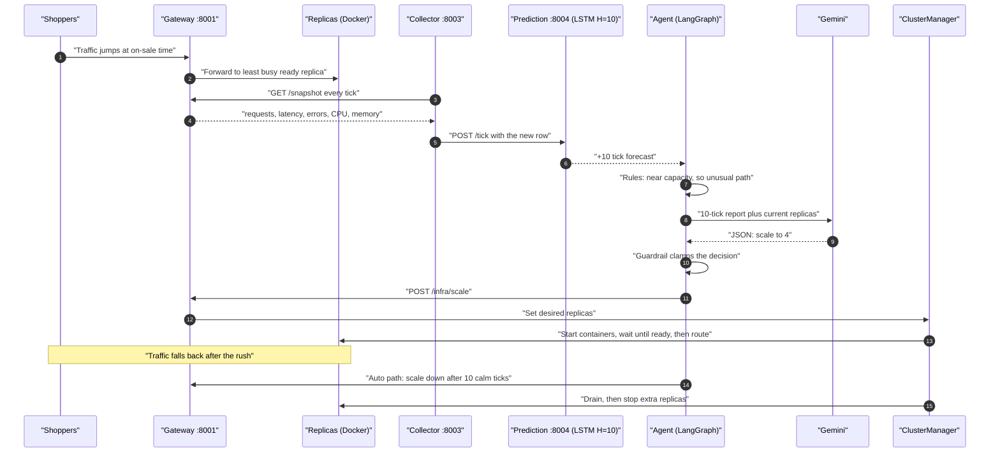
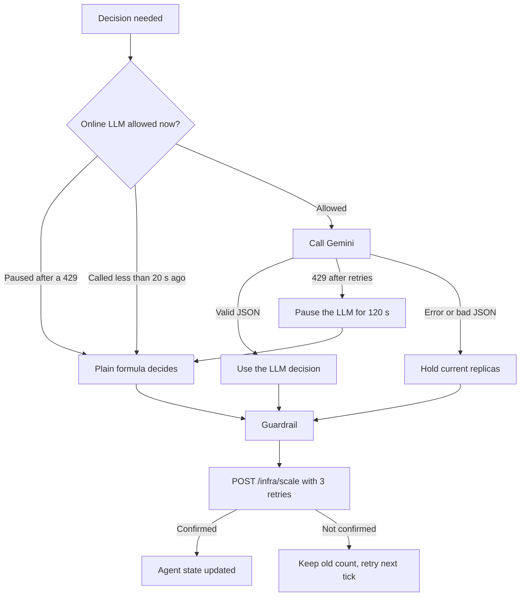
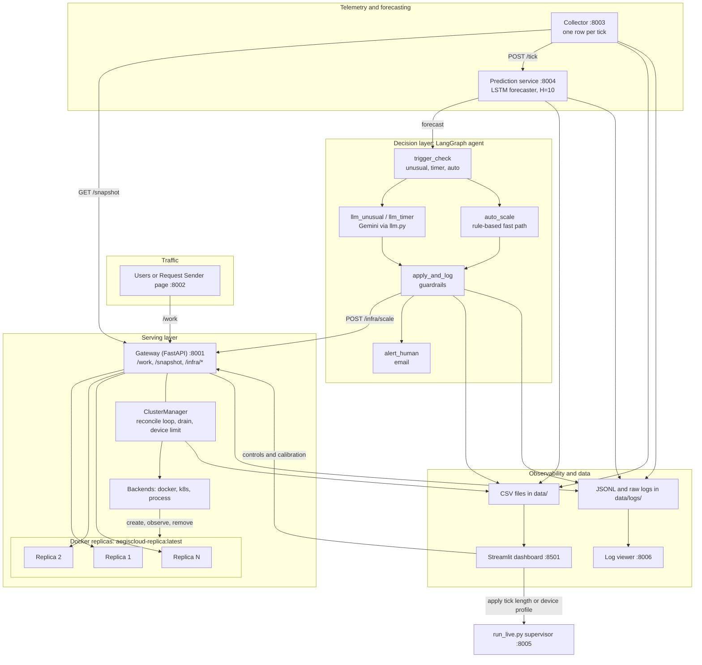
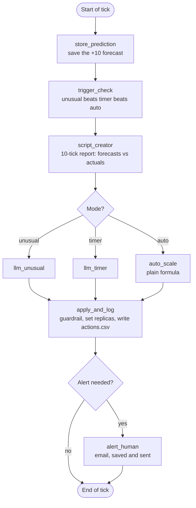

# AegisCloud

**A predictive, LLM-governed autoscaler that starts and stops real Docker containers to match web traffic.**

AegisCloud watches the traffic hitting an application, forecasts the next few minutes with an LSTM, and decides how many copies ("replicas") of the app should be running. A LangGraph agent backed by Gemini reviews unusual moments, a plain rule-based path handles everything else, and a guardrail layer limits every decision before it is applied to real containers.

> **Status in one line:** validated locally on Docker with 26,600+ minute-level ticks and 813K+ live requests. It has not been deployed to a cloud environment, and the Kubernetes backend has not been exercised end to end. See [Section 6](#6-scope-boundaries-and-what-not-to-overclaim).

---

## Contents

1. [Plain-language overview and organizational value](#1-plain-language-overview-and-organizational-value)
2. [Real-world example: a flash-sale surge, end to end](#2-real-world-example-a-flash-sale-surge-end-to-end)
3. [System architecture and end-to-end data flow](#3-system-architecture-and-end-to-end-data-flow)
4. [Tech stack and reliability hardening](#4-tech-stack-and-reliability-hardening)
5. [Setup and usage guide](#5-setup-and-usage-guide)
6. [Scope boundaries and what not to overclaim](#6-scope-boundaries-and-what-not-to-overclaim)

---

## 1. Plain-language overview and organizational value

### What it does, without the jargon

Think of a restaurant that adjusts its kitchen staff automatically. It looks at how busy the dining room has been, predicts the next rush, calls in extra cooks before the line gets long, and sends them home when the room quiets down. A manager reviews anything strange, and there are firm rules about how many cooks can be called in at once.

AegisCloud does this for web servers:

| Restaurant | AegisCloud |
|---|---|
| Dining room traffic | Incoming web requests |
| Cooks | Replicas, each one a Docker container running the application |
| "Looks like a rush is coming" | LSTM forecast of request volume 10 minutes ahead |
| Shift manager for odd situations | LangGraph agent calling Gemini |
| Standard staffing chart | Rule-based fast path (a plain formula, no AI) |
| House rules on hiring and firing | Guardrails: replica limits, maximum step size, device limits |
| Calling the owner | Alert email to a human |

### How it helps an organization

| Problem | What AegisCloud does |
|---|---|
| **Paying for idle capacity** during quiet hours | Scales replicas down after traffic has stayed low for several consecutive ticks, so you are not running peak capacity around the clock. |
| **Slow or failing pages during spikes** | Forecasts demand ahead of time and reacts to near-capacity and sudden jumps, so extra replicas are already starting when the surge lands. |
| **Blind AI actions** | The LLM never talks to Docker directly. Every decision passes a guardrail (min/max replicas, no more than double, at most +2 always allowed, no more than 25% removed per step) and a device limit enforced by the gateway. |
| **AI outages or rate limits** | If Gemini is rate limited or unavailable, a plain formula takes over so scaling continues. |
| **Silent failures** | Real latency and error rates measured at the gateway can trigger an alert email, independent of the capacity math. |
| **"What just happened?"** | Every tick, decision, replica event and log line is written to CSV or structured logs and shown on a dashboard. |

---

## 2. Real-world example: a flash-sale surge, end to end

> **Illustrative scenario.** The numbers below are invented to explain the flow. They are not measurements from this project. In AegisCloud's clock, **one tick = one simulated minute = 5 real seconds** by default (`AEGIS_TICK_SECONDS`, or `--tick` on `run_live.py`).

**The service:** an online ticketing site. Normally about 100 requests per tick, with each replica able to serve about 200 per tick. At "on-sale" time, traffic jumps to roughly 800 per tick, then drops back after the rush.

### What happens

1. **Telemetry flows in.** Every request enters the **Gateway**, which forwards it to the least busy ready replica. Every tick the **Collector** asks the gateway for a `/snapshot` (request count, p50/p95/p99 latency, errors, CPU, memory) and appends a row to `data/live/live_metrics.csv`.
2. **The forecast.** The Collector posts each row to the **Prediction service**, which turns the recent history into LSTM features and writes a +10 tick forecast to `data/predictions/predictions.csv`.
3. **The agent wakes up each tick** (LangGraph) and stores the forecast, then picks one of three paths, in priority order:
   - **Unusual** (plain-code rules decide, then the LLM is called): forecast jumped 30% or more versus the previous forecast (and is above 50% of current capacity), forecast or traffic is above 95% of capacity, or forecast error over the last 5 ticks is above 50%.
   - **Timer** (LLM): every 12 ticks, a routine review.
   - **Auto** (no LLM): a plain formula sized to the highest recent demand, scaling up immediately but scaling down only after 10 consecutive ticks that needed fewer replicas.
4. **The surge arrives.** Traffic jumps and the "near capacity" rule fires. The agent builds a short report of the last 10 ticks (forecasts versus actuals, current replicas), sends it to Gemini, and receives a JSON decision such as "scale to 4".
5. **Guardrails.** The decision is clamped: within `MIN_REPLICAS` and the device maximum, at most double (always allowed +2), and at most 25% removed per scale-down. If the LLM answer is malformed, the agent holds.
6. **The scale command.** The agent calls `POST /infra/scale` on the gateway. The **ClusterManager** compares desired with actual, starts new containers from `aegiscloud-replica:latest`, waits until each is healthy, and only then routes traffic to it. The device profile caps how many can run, and the gateway reports a clamp if the agent asks for more.
7. **Cooldown.** After the rush, the Auto path sees several ticks of low demand and scales down. The ClusterManager drains replicas (no new traffic, finish in-flight work) before stopping them.
8. **Everything is recorded** in `agent_ticks.csv`, `actions.csv`, `replica_events.csv`, `cluster_ticks.csv`, `resources.csv` and the JSONL logs, and shown live on the dashboard.



### Failure behavior in the same scenario

| What goes wrong | What AegisCloud does |
|---|---|
| **Gemini returns `429`** during the surge | Retries honor `Retry-After` with jitter. If still rate limited, the online LLM is **paused for 120 s** (`LLM_BREAKER_SECONDS`). During the pause the **plain formula decides**, so scaling continues. Alert emails still go out, written by plain code instead of the LLM. |
| **LLM calls arrive too fast** | A **20 s minimum gap** (`LLM_MIN_GAP_SECONDS`) between online calls, independent of tick length. A skipped call is decided by the plain formula. |
| **LLM returns garbage or times out** | The agent holds the current replica count and logs the error. |
| **The scale command times out** (for example the gateway is momentarily stalled) | `real_set_replicas` retries 3 times with a 6 s timeout. If the gateway still does not confirm, the agent **keeps its old replica count** and asks again next tick, so it never believes a scale happened when it did not. |
| **No replica is ready** | The gateway answers 503 and counts it as a real failure. This is not hidden. |
| **A CSV is locked** (for example open in Excel on Windows) | The write retries, then drops only that one row with a warning. The service keeps running. |



---

## 3. System architecture and end-to-end data flow

### 3.1 Components



### 3.2 What each part does

| Part | Location | Port | Role |
|---|---|---|---|
| **Gateway** | `infra/gateway.py` | 8001 | Single entry point. Forwards `/work` to the least busy ready replica, measures end-to-end latency, builds the `/snapshot` the collector reads, and exposes `/infra/scale`, `/infra/state`, `/infra/events`, `/infra/resources`, `/infra/device`, `/infra/reload`, `/infra/calibrate`. Returns 503 if no replica is ready. |
| **ClusterManager** | `infra/manager.py` | in gateway | Keeps the real replica count equal to the desired count, clamped to the device limit. Scale-down drains first. Records startup times, replica events and CPU/memory samples. |
| **Backends** | `infra/backends/` | | `docker` (real containers with CPU/memory limits), `k8s` (Pods of a Deployment), `process` (local processes, no limits, for machines without Docker). |
| **Replica image** | `infra/docker/Dockerfile.replica`, `infra/replica_app.py` | 8001 in container | One container per replica. The image copies `settings.py`, `traffic/`, **`obs/`** and **`ui/`** (the last two are imported by `traffic/target_app/app.py`). |
| **Collector** | `traffic/collector/app.py` | 8003 | Every tick, reads the gateway snapshot and appends a row to `data/live/live_metrics.csv`, then sends it to the prediction service. A failed tick is logged and skipped. |
| **Prediction service** | `prediction/server.py`, `engine.py`, `predictor.py`, `lstm_model.py` | 8004 | Preprocesses history (log1p, standardise, 60-row window plus 4 time features), runs the LSTM and writes `predictions.csv`. Multiple checkpoints for the same horizon are averaged. |
| **Request sender** | `traffic/loadgen/` | 8002 | Generates load (manual, timed schedule or demo scenario) and serves the sender web page. |
| **Agent** | `agent/` (graph in `graph.py`, nodes in `nodes.py`, LLM in `llm.py`) | metrics on 8000 | LangGraph pipeline described below. In live mode it is started through `infra.agent_real`, which replaces the placeholder scaler with a real call to the gateway. |
| **Dashboard** | `frontend/` | 8501 | Streamlit. Tabs: 01 Live, 02 Cluster, 03 Device & Timer, 04 Control, 05 Agent, 06 Data. |
| **Logging** | `obs/` | 8006 | Shared structured logging to `data/logs/<part>.jsonl`, a browser log page and a terminal viewer. |
| **Supervisor** | `run_live.py` | 8005 | Starts and stops every part, and lets the dashboard apply a new tick length or device profile by restarting the parts that need it. |

### 3.3 The agent graph



**Trigger rules (all plain code, in `agent/config.py`):**

| Rule | Default |
|---|---|
| Forecast jump versus the previous forecast | 30% or more, and forecast above 50% of current capacity |
| Near capacity | forecast or traffic above 95% of capacity (while more replicas are allowed) |
| Forecast error | WAPE above 50% over the last 5 ticks |
| Unusual cooldown | 6 ticks |
| Timer | every 12 ticks (60 real seconds at the default tick) |
| Scale-down patience (auto path) | 10 consecutive ticks needing fewer replicas |

**Guardrails (applied to every decision):** within min and max replicas, at most double per decision (always allowed +2), at most 25% removed per decision. An LLM "escalate to a human" only becomes an alert if plain code also sees load above 90% of capacity.

**Alerts** fire when the LLM asks for a human (and load is high), the LLM fails repeatedly, traffic is above capacity for 2 ticks in a row, the agent is at maximum replicas and still overloaded, or the gateway's real p95 latency or error rate stays bad (p95 above 500 ms for 6 busy ticks, or more than 5% errors for 3 busy ticks). The cooldown between alerts is 120 ticks. Email is sent over Gmail SMTP when `ALERT_SEND_EMAIL` is `True`, and always saved under `data/agent/alerts/`.

### 3.4 Data flow, step by step

1. **Requests** reach the Gateway and are spread across ready replicas.
2. **Each tick** the Collector reads `/snapshot` (a window of requests, ok/errors, p50/p95/p99, achieved requests per second, mean CPU and memory per replica) and writes one row to `live_metrics.csv`.
3. **The row is posted** to the Prediction service. The history starts from the seed file (`data/seed/metrics_combined.csv`) and continues with live rows. The LSTM predicts the change in log(requests) H ticks ahead, and a row lands in `predictions.csv`.
4. **The agent polls** the prediction service, runs one pass through the graph, and writes `agent_ticks.csv` and `actions.csv`.
5. **The scale call** goes to `POST /infra/scale`. The ClusterManager reconciles the real container count and logs every create, ready, drain and remove event.
6. **The dashboard** reads the CSV files directly and calls the gateway for live state. The log viewer reads `data/logs/*.jsonl`.

---

## 4. Tech stack and reliability hardening

### 4.1 Tech stack

| Area | Technology |
|---|---|
| Language | Python (replica image uses `python:3.11-slim`) |
| Services | FastAPI, Uvicorn, httpx, Pydantic |
| Forecasting | PyTorch LSTM, NumPy, pandas |
| Agent | LangGraph |
| LLM | Google Gemini API (configured models in `agent/config.py`, with automatic fallback model). Mistral is also supported by the code as an optional provider, and a `fake` rule-based provider is available for free testing. |
| Containers | Docker (Python `docker` SDK), plus Kubernetes manifests (`infra/k8s/`) and a Kubernetes backend (`kubernetes` Python client) |
| Dashboard | Streamlit, Plotly |
| Observability | Structured JSONL logging (`obs/`), CSV telemetry, optional Prometheus exporter on the agent (`prometheus_client`) |
| System metrics | psutil |
| Alerts | SMTP email (Gmail) |
| Testing | pytest, 100+ automated tests |

Dependencies are listed in `requirements.txt` (core) and `requirements-infra.txt` (Docker, Kubernetes, matplotlib for experiment figures).

### 4.2 Reliability hardening (pre-deployment audit)

A full audit reproduced the failures below in isolation and fixed them with minimal edits, without changing the architecture, schema or data. The complete table is in `CHANGES_PREDEPLOY.md`.

| Area | Hardening |
|---|---|
| **Replica image** | `Dockerfile.replica` now copies `obs/` and `ui/`. A freshly built image previously crashed with `ModuleNotFoundError: obs`. |
| **Silent service death** | The collector and agent skip a failing tick instead of stopping. |
| **Locked CSV files** | CSV appends in the agent, prediction engine and request sender retry, then drop only that row with a warning. |
| **Lost scale commands** | `real_set_replicas` retries 3 times with a 6 s timeout. On failure the agent keeps its old replica count and retries next tick. |
| **LLM call rate** | Minimum 20 s between online LLM calls (`LLM_MIN_GAP_SECONDS`), independent of tick length. |
| **429 handling** | `Retry-After` honored, jitter added, and a surviving 429 pauses the online LLM for 120 s (`LLM_BREAKER_SECONDS`). The plain formula decides during the pause and alert emails still send. |
| **Gateway freezes** | Calibration no longer holds the routing lock during a slow Docker create. With a simulated 3 s create, worst `/health` and `/work` latency measured 228 ms, against about 2,750 ms before the fix. |
| **Misleading startup times** | Containers adopted from an earlier run no longer record their age as a startup time. |
| **Memory growth** | The gateway's per-window latency list is bounded at 200,000 entries. |
| **Dashboard stalls** | Read-only dashboard calls to a service that just failed are skipped for 6 seconds, so a stalled backend does not make every refresh wait for the full timeout. |
| **Log viewer cost** | The viewer reads only the files of the app it is asked for. |
| **Log noise** | Harmless Windows connection-reset tracebacks and a plotly warning are suppressed. |
| **Tests** | 10 new tests in `tests/test_hardening.py` cover the items above. |

**Test status from the audit:** 101 tests passed in a sandbox. `tests/test_prediction.py` needs PyTorch and was not run there, so run it on your own machine.

---

## 5. Setup and usage guide

### 5.1 Prerequisites

- Python 3.11 or newer
- Docker running (default backend). Without Docker, use `--backend process`.
- A Gemini API key if you want the real LLM. The default provider is `fake`, which needs no key.
- Optional: a Gmail app password for alert emails.

### 5.2 Install

```bash
# from the project root
python -m venv .venv
# Windows:  .venv\Scripts\activate        macOS/Linux:  source .venv/bin/activate

pip install -r requirements.txt
pip install -r requirements-infra.txt     # Docker SDK, Kubernetes client, matplotlib
```

### 5.3 Configure keys

Create `agent/.env` from the template `agent/.env.example` (a project-root `.env` also works, and `agent/.env` takes priority):

```ini
GEMINI_API_KEY=your_gemini_key_here
EMAIL_SENDER=your_email_id
EMAIL_PASSWORD=your_gmail_app_password
EMAIL_TO=email_id_of_receiver
# MISTRAL_API_KEY is optional and only used if you choose the mistral provider
```

**Security:**

- **Rotate exposed keys.** A copy of this project that included a populated `agent/.env` was shared during the audit. Rotate the Gemini key, the email app password and any Grafana password before deploying.
- **Never zip or commit `.env`.** It is listed in `.gitignore`.
- **Use a Gmail app password**, not your normal password.
- **To save alerts without sending them**, set `ALERT_SEND_EMAIL = False` in `agent/config.py`. Alerts are always saved under `data/agent/alerts/`.

### 5.4 Provide data and models

| Needed | Where | Notes |
|---|---|---|
| Seed history | `data/seed/metrics_combined.csv` | Needs a `minute` column plus the 8 metric columns: `requests`, `p50_ms`, `p95_ms`, `p99_ms`, `achieved_rps`, `app_cpu_pct`, `host_cpu_pct`, `app_mem_mb`. At least **1,441 consecutive rows** (one simulated day plus one). |
| LSTM checkpoints | `prediction/models/*.pt` | All checkpoints for the same horizon are averaged by the predictor. |

> **Careful with demo assets.** `python run_all.py --demo` and `tools/make_demo_assets.py` create **fake** data and models for a quick look. Never use them for anything you report, and never run them where your real seed data lives.

### 5.5 Rebuild the replica Docker image

An image built before the `Dockerfile.replica` fix will not contain `obs/` and `ui/`, and a fresh build from the old Dockerfile fails. The image is only built when it does not already exist, so remove the old one first:

```bash
# 1. stop the system (Ctrl+C in the run_live.py terminal) and remove any leftover replica containers
docker rmi aegiscloud-replica:latest

# 2. start the system: the image is rebuilt from infra/docker/Dockerfile.replica on first start
python run_live.py
```

### 5.6 Data collection

Collection is automatic once the system runs. Everything lives under `data/`:

| File | Written by | Content |
|---|---|---|
| `live/live_metrics.csv` | Collector | One row per tick: tick, minute, wallclock, load mode, planned, ok, errors, requests, p50/p95/p99, achieved rps, CPU, memory |
| `predictions/predictions.csv` | Prediction service | Minute, current requests, +10 forecast and its target minute, history source, drift measures. The `forecast_h20` columns stay empty until an H=20 model exists. |
| `agent/agent_ticks.csv`, `agent/actions.csv` | Agent | Per-tick state and every decision. Files are appended to by default, and `--fresh` clears them. |
| `agent/alerts/` | Agent | Saved alert emails |
| `loadgen/load_ticks.csv`, `loadgen/events.csv` | Request sender | Planned, sent and failed per tick, plus start/stop events |
| `infra/cluster_ticks.csv`, `infra/replica_events.csv`, `infra/resources.csv` | Gateway and ClusterManager | Cluster state per tick, every create/ready/drain/remove event with startup times, and per-replica CPU and memory samples |
| `infra/runtime.json`, `infra/device_profile.json`, `infra/calibration.json` | Dashboard and gateway | Saved tick length, device limits, and the measured capacity per replica |
| `logs/<part>.jsonl` and `.log` | Every part | Structured and raw logs |

To grow the dataset, drive traffic with the request sender (dashboard **04 Control**, or the sender page on port 8002) and leave the system running. The `minute` counter continues across restarts so the time-of-day features stay correct. Note that `cluster_ticks.csv` restarts its `tick` counter at 0 on each gateway restart, so use `ts` as the key when analyzing it.

### 5.7 Model training

The LSTM is trained offline. The forecaster follows a fixed recipe: `log1p`, standardise, a 60-row window plus 4 time features, predict the standardised change in log(requests) H ticks ahead, 40 epochs of Adam, and keep the best validation epoch.

```bash
python -m prediction.training.train_horizon \
    --data data/seed/metrics_combined.csv \
    --horizons 10 20 --seeds 3 --train-fraction 1.0 --out prediction/models
```

| Flag | Meaning |
|---|---|
| `--horizons` | Forecast horizons in ticks (default `10 20`) |
| `--seeds` | Seeds per horizon. More than 1 builds an ensemble that the predictor averages. |
| `--epochs` | Default 40 |
| `--train-fraction` | Default 0.7 trains on 70% and evaluates on the last 30%. `1.0` trains on all rows for a final deployed model. |
| `--out` | Output folder (default `prediction/models`) |

**Status of the horizons:**

- **H=10 models are present** in `prediction/models/` (`lstm_requests_forecaster.pt` and `lstm_h10_seed0.pt`). Because both are H=10, the predictor averages them.
- **H=20 needs a trained model, not a code change.** No H=20 checkpoint exists, so the +20 forecast shows `n/a` everywhere. The training script already supports it: run the command above with `--horizons 20` and place the checkpoint in `prediction/models/`.
- **Mind evaluation leakage.** A checkpoint trained with `--train-fraction 1.0` has seen all seed rows. Do not evaluate it on those same rows and call that a held-out result. `lstm_h10_seed0.pt` was trained this way.

### 5.8 Run and monitor

```bash
python run_live.py                           # Docker replicas (default)
python run_live.py --backend process         # local processes, no Docker, no CPU/memory limits
python run_live.py --backend k8s             # Kubernetes Pods (cluster must already be running)
python run_live.py --tick 10                 # 10 real seconds per simulated minute
python run_live.py --provider gemini         # use the real LLM (key in .env)
python run_live.py --no-agent                # system without the agent
python run_live.py --no-frontend             # no dashboard
python run_live.py --timer 12                # ticks between routine LLM checks
```

Stop everything with **Ctrl+C**.

| What | Where |
|---|---|
| Dashboard | http://localhost:8501 |
| Live logs in the browser | http://localhost:8006 (or `python -m obs.web`) |
| Live logs in the terminal | `python -m obs.viewer --follow` |
| Request counter page | http://localhost:8001 |
| Request sender page | http://localhost:8002 |
| Agent Prometheus metrics (optional) | port 8000 (`--metrics-port` on the agent, `--no-metrics` to disable) |
| Supervisor API | port 8005 |

**Suggested first run:**

1. Open the dashboard, go to **03 Device & Timer**, and enter your machine's cores and RAM. This sets the maximum replicas.
2. Run calibration from the dashboard (**02 Cluster**) to measure real capacity per replica. Calibration is sensitive to machine load, so run it on an otherwise idle machine and repeat if two runs disagree.
3. Start traffic from **04 Control** or the sender page, and watch **01 Live**, **02 Cluster** and **05 Agent**.

**Benchmark experiments (optional).** `infra/experiments/run_experiment.py` compares `static`, `reactive`, `hpa` and `aegis` policies on the same spike with real replicas. Run the baselines with `python run_live.py --no-agent --no-frontend`, run the `aegis` policy with the agent enabled, then draw figures:

```bash
python -m infra.experiments.run_experiment --policy static --static-n 3 --reps 3
python -m infra.experiments.run_experiment --policy reactive --reps 3
python -m infra.experiments.run_experiment --policy hpa --reps 3
python -m infra.experiments.run_experiment --policy aegis --reps 3
python -m infra.experiments.plot             # figures and a table in data/experiments/
```

**Tests.** Tests are configured in `pytest.ini` (`tests/`). Point `AEGIS_DATA_DIR` at a scratch folder so tests can never touch your live CSVs:

```bash
# macOS/Linux
AEGIS_DATA_DIR=/tmp/aegis_test python -m pytest -q

# Windows PowerShell
$env:AEGIS_DATA_DIR="$env:TEMP\aegis_test"; python -m pytest -q
```

`tests/test_prediction.py` needs PyTorch (installed by `requirements.txt`).

### 5.9 Key settings

| Setting | File | Default |
|---|---|---|
| Tick length | `settings.py` (`AEGIS_TICK_SECONDS`) or `--tick` | 5 s per simulated minute |
| Ports | `settings.py` and `infra/config.py` (`AEGIS_PORT_*`) | gateway 8001, sender 8002, collector 8003, prediction 8004, supervisor 8005, logs 8006, dashboard 8501 |
| Timer, unusual cooldown, thresholds | `agent/config.py` | 12 ticks, 6 ticks, see Section 3.3 |
| LLM provider | `agent/config.py` (`LLM_PROVIDER`) or `--provider` | `fake` |
| LLM call gap and 429 pause | `agent/config.py` | `LLM_MIN_GAP_SECONDS = 20`, `LLM_BREAKER_SECONDS = 120` |
| LLM retries and timeout | `agent/config.py` | `LLM_RETRIES = 2`, `LLM_RETRY_WAIT = 2`, `LLM_TIMEOUT = 30` |
| Gemini models | `agent/config.py` | `GEMINI_MODEL` with `GEMINI_FALLBACK_MODEL` |
| Data folder | `AEGIS_DATA_DIR` | `data/` |
| Replica image | `infra/config.py` | `aegiscloud-replica:latest` |

---

## 6. Scope boundaries and what not to overclaim

This section states exactly what has and has not been shown. Please keep claims about this project within it.

### What has been validated

| Item | Evidence |
|---|---|
| **Scale of data** | 26,646 minute-level ticks (about 18.5 simulated days): 20,160 seed ticks plus 6,486 live ticks |
| **Live traffic served** | 813,567 requests through the gateway, 0.27% error rate, 39 ms median latency, about 141 requests/s peak |
| **Agent behavior** | 1,181 agent ticks, 119 LLM-driven decisions with 0 LLM errors, replicas used between 1 and 4 |
| **Real containers** | 131 replica-ready events on Docker, median startup 7.2 s (p90 9.7 s, excluding an adopted-container outlier) |
| **Code** | 77 Python files, about 8,300 lines, 100+ automated tests |

All figures come from a local run on the project author's machine using Docker.

### Forecast quality: benchmarked, not improved

On 6,466 live +10 tick forecasts, the LSTM matched a naive persistence baseline ("the next value equals the current value"):

| Metric | LSTM | Persistence baseline |
|---|---|---|
| MAE (requests per tick) | about 58.5 | about 58.3 |
| WAPE | about 46.6% | about 46.4% |

It was slightly worse on the busiest 10% of ticks. **Do not claim the forecaster improves accuracy over the baseline.** The accurate statement is that the forecaster was benchmarked against a persistence baseline. This is also why the agent does not rely on the forecast alone: its rule-based path and its LLM prompt use actual traffic and the recent peak as well.

### What this project is not

| Do not say | Say instead |
|---|---|
| "Deployed to production" or "running in the cloud" | "Validated locally on Docker" |
| "Runs on Kubernetes" | "Includes Kubernetes manifests and a Kubernetes backend." The audit's runs used the Docker backend, and the Kubernetes path was not exercised. |
| "The forecaster beats the baseline" | "Benchmarked the forecaster against a persistence baseline" |
| "Forecasts 20 minutes ahead" | "Forecasts 10 minutes ahead. An H=20 model needs to be trained." |
| "Saves X% cost" | No cost-savings figure has been measured. The experiment runner exists to produce one, but no results are claimed here. |

### Known limitations

- **Time compression.** One simulated minute is 5 real seconds, but container startup is real time (about 7 s, or roughly 1.4 ticks). Results do not map one-to-one to a real cluster running at real-time scale.
- **Calibration sensitivity.** The measured capacity per replica depends on machine load at the time of measurement. A bad calibration can cause over- or under-provisioning, so repeat it on an idle machine.
- **Load generator is open-loop.** It keeps sending at the planned rate even when the gateway is saturated, so heavy saturation shows up as latency and errors.
- **Single machine.** The gateway is one process on one event loop. This is fine for the measured load (about 141 requests/s peak), and has not been tested beyond it.
- **Dashboard responsiveness is unverified in a real browser.** The audit fixed the blocking calls that most plausibly cause lag, but a hang could not be reproduced server-side.
- **Unbounded CSV growth.** `data/infra/resources.csv` and the events files grow without limit.
- **The H=10 ensemble includes a checkpoint trained on all seed rows** (`--train-fraction 1.0`), so evaluating on the seed rows would be leakage.
- **LLM model names are configuration, not guarantees.** The Gemini model names in `agent/config.py` must exist for your API key. If a model is retired, change the config.

### Repository layout

| Path | Contents |
|---|---|
| `run_live.py`, `run_all.py` | Start the whole system (real replicas / demo target app) |
| `settings.py`, `seed.py` | Shared settings and seed-data helpers |
| `agent/` | LangGraph agent, LLM layer, mailer, health check, Prometheus exporter |
| `prediction/` | Prediction service, LSTM model, training scripts, checkpoints |
| `infra/` | Gateway, ClusterManager, backends, calibration, device profile, Dockerfile, Kubernetes manifests, experiments |
| `traffic/` | Collector, request sender (loadgen), demo target app |
| `frontend/` | Streamlit dashboard |
| `ui/` | Request counter and sender web pages |
| `obs/` | Structured logging, log viewer (terminal and web) |
| `tools/` | Demo asset generator (fake data, do not use for reporting) |
| `tests/` | pytest suite |
| `data/` | All CSV, JSON and log files (see Section 5.6) |
| `CHANGES_PREDEPLOY.md` | The pre-deployment hardening change list |
