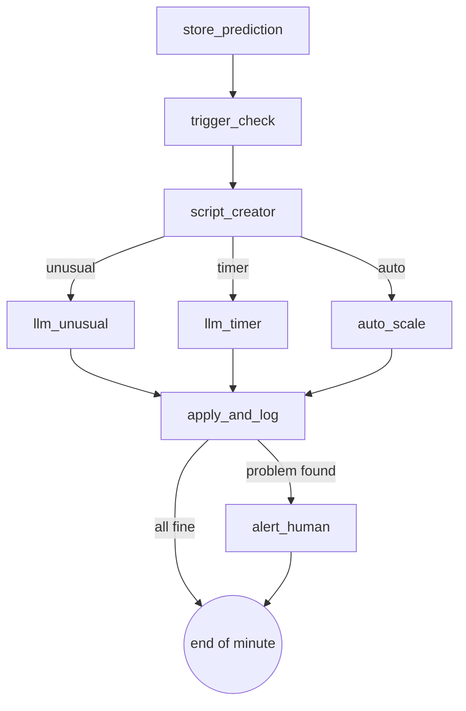

# AegisCloud agent (LangGraph)

The agent replays a traffic dataset one row per "minute". Every minute the graph runs once: it forecasts traffic 10 minutes ahead, decides how many replicas to run, applies a safety limit, logs the decision, and emails a human only when something is really wrong.

Plain code makes most decisions. The LLM is called only on a timer or when something unusual happens.

## The graph



| # | Node | What it does | LLM? |
|---|---|---|---|
| 1 | `store_prediction` | Reads this minute's traffic, runs the LSTM for the forecast at +10 min, appends a row to `data/predictions.csv` | No |
| 2 | `trigger_check` | Picks the mode. Priority: **unusual > timer > auto** | No |
| 3 | `script_creator` | Writes a text report of the last 10 minutes: actual traffic, what was predicted earlier for that minute, the error, the new forecast, replicas, last 3 actions | No |
| 4 | `llm_unusual` | LLM decision because something unusual happened | Yes |
| 5 | `llm_timer` | LLM decision because the timer is due | Yes |
| 6 | `auto_scale` | Plain formula. Scales up at once, scales down only after the last 10 minutes all needed fewer replicas | No |
| 7 | `apply_and_log` | Guardrail, set replicas, write `data/actions.csv`, count LLM failures, decide whether an alert is needed | No |
| 8 | `alert_human` | Only if something is wrong. The LLM writes an urgent email, it is saved in `data/alerts/` and sent if email is on | Yes |

## The three modes

| Mode | When | Default |
|---|---|---|
| `unusual` | Forecast jumps more than 30% in one minute (and is above 50% of capacity), **or** forecast or traffic is above 95% of capacity, **or** forecast error over the last 5 minutes is above 50% | cooldown 3 min |
| `timer` | Every N minutes since the last LLM check. An unusual call resets the timer | every 5 min |
| `auto` | Everything else | |

## Guardrail

Applied to every decision, whether it comes from the LLM or the formula:

1. Replicas stay between `MIN_REPLICAS` and `max_replicas`.
2. One decision can at most double the replicas (always +2 is allowed).
3. One decision can at most remove 25% of the replicas (always -1 is allowed).

The LLM answer is checked before the guardrail: it must be a JSON object with a numeric `replicas`. If the LLM times out, has no key, or returns garbage, the agent **holds** the current replicas and records the error.

## The LLM layer (`llm.py`)

| Step | What happens |
|---|---|
| Provider | `fake` (formula, free), `gemini` or `mistral`. Chosen by `LLM_PROVIDER` or `--provider` |
| Retries | Busy-server answers (429, 500, 502, 503, 504) and dropped connections are retried `LLM_RETRIES` times, waiting 2 s, then 4 s. Real errors (wrong key, wrong model name) are raised at once with the server's text |
| Fallback model | Gemini tries `GEMINI_MODEL` first. If it fails, it tries `GEMINI_FALLBACK_MODEL`. Set it to `""` to turn the fallback off |
| Reply check | `parse_reply` extracts the JSON, rejects non-numbers, clamps replicas to min and max, and recomputes the action from the numbers |
| Failure | The agent holds the current replicas and the decision carries `error: true`. `run.py` prints the full text as `LLM ERROR` |
| Alert email | `write_alert_email` asks the LLM. If it fails, `template_email` builds a plain-code email, so an alert is never lost |

## Alerts

An alert fires when:

1. the LLM sets `"escalate": true` (scaling cannot fix it: attack-like traffic, a bug, unreliable forecasts),
2. the LLM failed `LLM_FAILURES_BEFORE_ALERT` times **in a row** (default 2),
3. traffic was above capacity for 5 minutes in a row, or
4. replicas are at the maximum and traffic is still above capacity.

A 30-minute cooldown prevents email spam. The email carries two CSV files: `last_hour_predictions.csv` and `last_actions.csv`. The email is saved as `data/alerts/alert_<minute>.txt` even when sending is off.

`force_alert` (a key in the state) is for tests only. It forces an alert and ignores the cooldown. `test/graph_tester.py` uses it.

## The state

Every node receives the state dictionary and returns **only the keys it changes**. LangGraph merges them. Two groups:

- **Carried keys**, kept by `run.py` from one minute to the next: `replicas`, `capacity`, `max_replicas`, `last_timer_minute`, `last_unusual_minute`, `last_alert_minute`, `llm_failures`.
- **Per-minute keys**, filled again every minute: `pos`, `minute`, `traffic_now`, `forecast`, `mode`, `reason`, `script`, `decision`, `applied`, `alert_reason`, `alert_status`.

> **Important rule:** every key a node returns must be declared in `AgentState` (`state.py`). LangGraph silently drops undeclared keys. If you add a new key to a node and forget `state.py`, nothing fails, but the value is lost. **Check that `llm_failures: int` is declared**, otherwise the "2 failures in a row" alert never fires.

## Folder

```
agent/
  config.py      every setting
  state.py       the dictionary passed between nodes
  llm.py         fake / Gemini / Mistral, retries, fallback, reply checking, alert email writer
  mailer.py      SMTP email (Gmail, SSL on port 465)
  nodes.py       the 8 nodes and the guardrail
  graph.py       wiring
  run.py         start here
  .env           your keys (copy from .env.example, never commit it)
  data/          created on each run: predictions.csv, actions.csv, alerts/
```

The agent needs `notebook/predict.py`, `models/<app>.pt` and `data/dataset.csv` from the project root.

## Setup and run

From the project root:

```bash
pip install -r requirements.txt
python agent/run.py --minutes 120 --tick 0                            # fake LLM, no keys
python agent/run.py --provider gemini --timer 3 --minutes 60 --quiet  # real LLM
python agent/run.py --provider gemini --email                         # also send alert emails
```

| Option | Meaning |
|---|---|
| `--minutes N` | Replay N minutes (default: until the data ends) |
| `--tick S` | Seconds between minutes (default 1, `0` = as fast as possible) |
| `--timer N` | Minutes between normal LLM checks (default 5) |
| `--app app_1` | Which app to replay (needs a model file for it) |
| `--provider` | `fake`, `gemini` or `mistral` |
| `--email` | Really send alert emails |
| `--quiet` | Print only minutes with an LLM call, a replica change or an alert |

`Ctrl+C` stops safely. The CSV files are already written and a summary is printed.

## How to check that everything works

Run these in order. Each one tests a bigger part.

| # | Command | You should see |
|---|---|---|
| 1 | `python notebook/predict.py --app app_62 --backtest` | `WAPE=0.027` or close |
| 2 | `python test/llm_tester.py --provider fake` | `RESULT: OK` twice |
| 3 | `python test/llm_tester.py --provider gemini` | `API key : found in .env`, then `RESULT: OK` twice |
| 4 | `python test/graph_tester.py` | 28 passed, 0 failed |
| 5 | `python test/graph_tester.py --provider gemini` | 29 passed, 0 failed |
| 6 | `python test/graph_tester.py --provider gemini --send-email` | 30 passed, 0 failed, and one email in the inbox |
| 7 | `python agent/run.py --minutes 120 --tick 0` | a summary with no crash |
| 8 | `python agent/run.py --provider gemini --timer 3 --minutes 60 --quiet` | LLM calls, no `LLM ERROR` lines |

`graph_tester.py` writes only to `test/output/`, so `agent/data/` is not touched. It forces every part of the graph to run:

| Minute (0-based) | What is forced |
|---|---|
| 2 | An "unusual" event (the near-capacity threshold is lowered for that minute) |
| 5, 8, 11 | The timer is due (set to every 3 minutes for the test, counted from the unusual call at minute 2) |
| 8 | An alert (`force_alert`), on the same minute as a timer call |

## Where to change things

Everything is in `config.py`: timer, thresholds for "unusual", guardrail limits, alert rules, retries, model names, SMTP settings.

`set_replicas()` in `nodes.py` is the one place to connect Docker or Kubernetes later. Today it does nothing, and in the replay new replicas count as instant.

## Known issues

- `llm_failures` must be declared in `AgentState` (see the important rule above).
- `nodes.py` has the `force_alert` check twice in `alert_reason_for`. Keep one. A comment mentions `run.py --test-alert`, which does not exist.
- `config.py` has `SMTP_PORT_STARTTLS = 587` ("tried automatically if SSL fails"), but `mailer.py` only uses SSL on 465. Either add the fallback or remove the line. On a network that blocks port 465 (some hostel Wi-Fi), the email will time out.
- The graph reads `predictions.csv` several times per minute. Fine for a replay, too slow and fragile for a live loop.
- The Mistral provider has not been run against the real API yet.